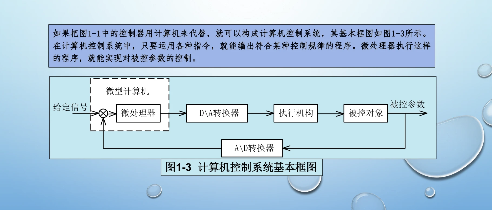
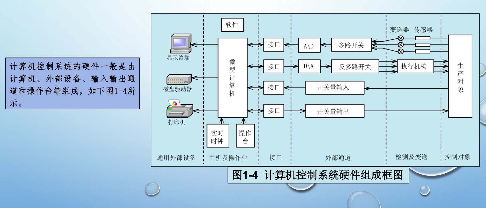
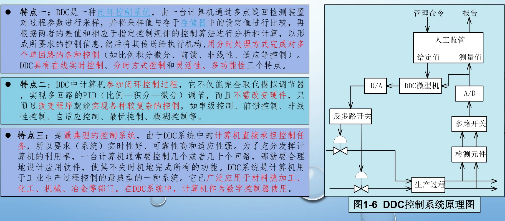
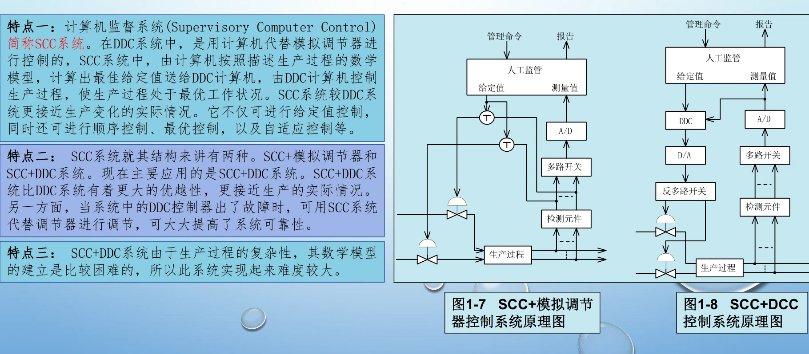
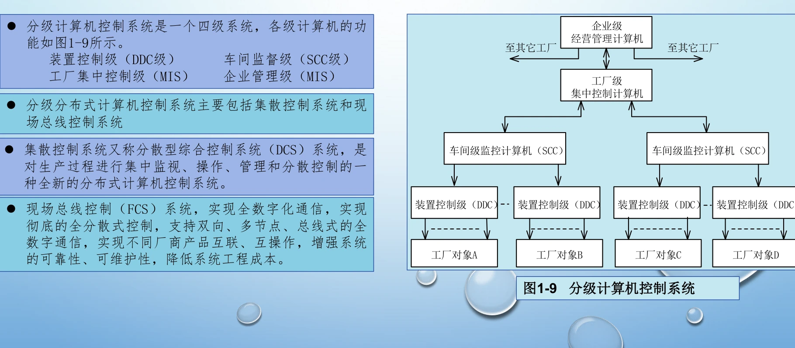
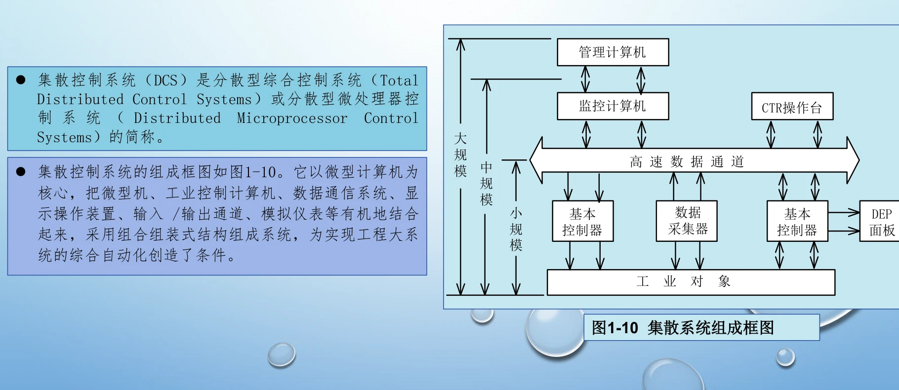

# 第 1 章 · 计算机控制系统概述

> 第 1 章 · 计算机控制系统概述

## 1.1 控制任务、系统组成与工作过程

**本节要回答：计算机怎样进入控制回路？** 控制系统先测量被控量，把测量值与给定值比较得到偏差，再按控制规律计算控制量，经过执行机构作用于对象，形成反馈闭环。计算机承担数据采集、偏差计算、控制运算和输出管理等任务。

典型通道是“传感器 → 信号调理 → A/D → 计算机 → D/A 或开关量输出 → 执行机构 → 被控对象”。A/D 把连续幅值转换成数字量；D/A 与保持环节把数字控制量转换成对象可接受的信号。模拟量通道和开关量通道要分别理解，并非每个系统都必须具有 D/A。

与连续模拟控制相比，计算机控制具有采样、运算和更新输出的时序。分析系统时既要说明控制规律，也要交代采样周期、计算延迟、接口和执行器约束。课程学习的主线因此是：组成与接口 → 离散建模 → 数字控制器设计 → 实现与调试。

### 从偏差到控制输出

用同一组符号把控制回路串起来：给定值为 \(r[k]\)，测量值为 \(y[k]\)，偏差为 \(e[k]\)，控制器输出为 \(u[k]\)。每拍先取得测量值，再计算偏差和输出，最后更新执行机构。

$$
\begin{gathered}
e[k]=r[k]-y[k],\qquad u[k]=\mathcal{D}\{e[k],e[k-1],\ldots\}
\end{gathered}
$$

<!-- references:computer-control-chapter-01:1 -->

## 1.2 直接数字控制、监督控制与分级控制

**区分依据是计算机承担哪一层任务，而不是设备数量。** 直接数字控制 DDC 中，计算机直接采集反馈量、计算控制输出并闭合控制回路；监督控制 SCC 中，上层计算机主要进行优化、设定值调整和运行监督，具体回路可由下层调节器维持。

分级控制把现场控制、过程协调、生产管理等任务分配给不同层级。上层重视全局协调与优化，下层重视实时性、可靠性和局部回路的连续运行。复习时可从控制任务、数据流、实时要求和上层故障对下层的影响四个角度比较。

不要把“上位机显示曲线”直接等同于监督控制，也不要把 DDC 理解成取消传感器、接口或执行机构。判断系统类型时，应画出实际闭环，标明给定值、反馈量和控制量由谁处理。

### 沿着闭环判断系统类型

先找“谁实际计算控制量”。DDC 由计算机直接闭合控制回路；SCC 的上层负责优化和修改下层设定值。分级系统进一步把管理、监督和现场控制分开。

<!-- references:computer-control-chapter-01:2 -->

## 1.3 发展方向与系统设计关注点

课件把计算机控制的发展与仪表的微型化、多功能化、智能化、网络化联系起来。网络和分级体系使信息共享与任务分配更方便，但闭环性能仍取决于测量质量、控制规律、执行能力和各环节的时间特性。

设计一个系统，可按“明确被控量与指标 → 选择传感器和执行器 → 配置接口 → 建立模型 → 选择采样周期和控制方法 → 验证性能与故障处理”组织思路。精度、响应速度、稳定性和可靠性往往需要综合权衡。

**复习自查：** 能否完整画出一条计算机控制回路？能否解释采样、量化、保持分别发生在哪里？能否指出 DDC、SCC 和分级系统的任务边界？把这三个问题讲清楚，比按课件页码记定义更有用。

### 把设备选择放回系统任务中

工业计算机、PLC 和 DCS 的比较，应围绕计算任务、输入输出规模、实时性、可靠性与维护条件进行。DCS 的分散控制与集中监视关系如下，不能把“集中显示”理解为所有控制都由同一台机器完成。

<!-- references:computer-control-chapter-01:3 -->
