# 第 2 章 · 信号转换与接口技术

> 第 2 章 · 信号转换与接口技术

## 2.1 信号采样、采样定理与量化

**采样解决“何时取值”，量化解决“用多少个等级表示幅值”。** 对连续信号 x(t) 每隔 T 取一次值，得到 x[k] = x(kT)，采样频率为 fₛ = 1/T。采样使时间离散；A/D 转换还会使幅值量化，二者不能混为一谈。

对严格带限且最高频率为 fₘ 的信号，理想重构要求采样频率高于 2fₘ，并满足相应带限条件。采样频率过低时，不同频率成分会混叠，事后提高数字运算精度不能恢复已经混叠的信息，因此实际采样前要考虑抗混叠滤波。

N 位量化可区分 2ᴺ 个码。若输入范围宽度为 FSR，常用理想量化步距是 q = FSR/2ᴺ；具体满量程码值的换算要遵循器件定义。四舍五入量化的理想误差界约为 ±q/2，截断量化的误差区间不同。

采样周期的选择还必须考虑对象动态、闭环带宽、计算时间、噪声和执行器能力；仅满足采样定理不等于已经获得合适的控制性能。采样过慢会增加等效延迟，过快则可能增加计算负担并放大测量噪声的影响。

### 采样的数学表达与频谱混叠

$$
\begin{gathered}
x[k]=x(kT),\quad f_s=\frac1T,\quad\omega_s=\frac{2\pi}{T}
\\x^*(t)=\sum_{k=0}^{\infty}x(kT)\delta(t-kT)
\end{gathered}
$$

$$
\begin{gathered}
X^*(j\omega)=\frac1T\sum_{m=-\infty}^{\infty}X\bigl(j(\omega-m\omega_s)\bigr)
\\f_s>2f_{\max}
\end{gathered}
$$

上式的频谱复制表达针对双边冲激列。严格带限、理想采样与理想重构是采样定理的前提；工程上通常留出余量，并在采样之前抑制带外成分。

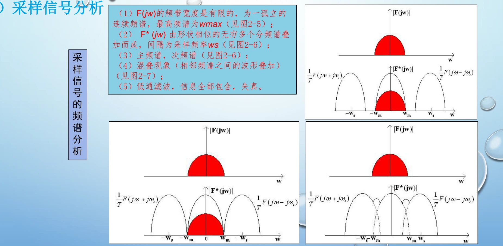

### 量化步距与编码例题

课件分别使用了两种量程约定：等宽量化区间采用 \(q=\mathrm{FSR}/2^N\)；把最小码和最大码分别对应两个端点时，端点间距为 \(q_{\rm end}=\mathrm{FSR}/(2^N-1)\)。二者不能混用。8 位、0～5 V 时，前者为 19.53125 mV，后者约为 19.608 mV。

$$
\begin{gathered}
q=\frac{\mathrm{FSR}}{2^N},\qquad |e_q|\leq\frac q2\quad\text{（舍入，未过载）}
\end{gathered}
$$

例：按课件 8 位单极性编码的等宽区间口径，输入 3.9 V，先计算码值，再按指定舍入规则取整数。

$$
\begin{gathered}
d=\frac{3.9}{5}\,256=199.68\ \longrightarrow\ 200=(11001000)_2
\\\hat U=\frac{200}{256}\,5=3.90625\ \mathrm V
\end{gathered}
$$

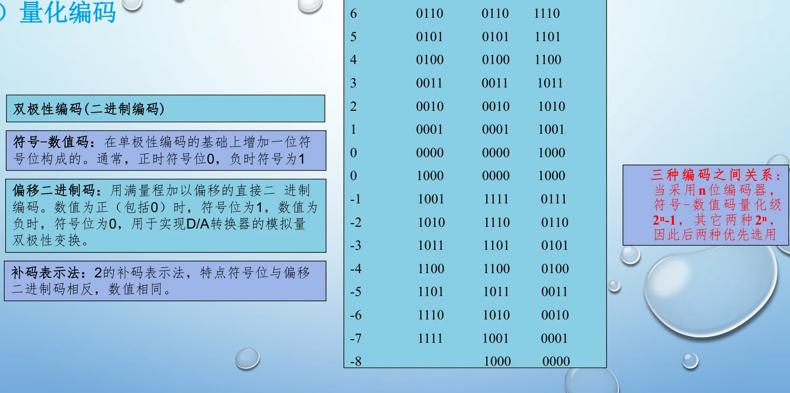

<!-- references:computer-control-chapter-02:1 -->

## 2.2 信号重构与零阶保持器

重构是利用离散样值恢复连续时间信号。理想低通重构可以在理想带限和采样条件下恢复信号，但理想滤波器无法原样实现，所以实际系统通常使用保持器及后续对象完成接口转换。

零阶保持器把当前样值维持一个采样周期，输出呈阶梯状，其传递函数可写为 \(H_0(s)=\frac{1-e^{-sT}}s\)。这个保持动作会改变幅频和相频特性，不能在分析闭环时把 D/A 输出简单当成原连续信号。

本节可与采样合起来理解：采样把连续信号变为样值序列，保持则把控制序列变为连续时间的分段常值信号。研究采样周期对误差、相位和稳定性的影响时，要同时考虑这两个方向的转换。

**常见问题：** “采样越快越好吗？”应先说明对象频带和性能要求，再核对计算、通信与输出更新能否按时完成，而不是只追求更小的 T。

### 理想重构与保持器的区别

在理想带限条件下，可用样值构造原信号。这里定义 \(\operatorname{sinc}(v)=\sin(\pi v)/(\pi v)\)。

$$
\begin{gathered}
x(t)=\sum_{k=-\infty}^{\infty}x(kT)\operatorname{sinc}\!\left(\frac{t-kT}{T}\right)
\end{gathered}
$$

零阶保持器的单位冲激响应只在一个采样周期内为 1，因此对它作拉普拉斯变换即可得到传递函数。注意直流增益为 T；与单位增益的近似保持环节比较时，需要先归一化。

$$
\begin{gathered}
h_0(t)=\begin{cases}1,&0\leq t<T\\0,&\text{其他}\end{cases}
\\H_0(s)=\int_0^T e^{-st}\,dt=\frac{1-e^{-sT}}s
\\H_0(j\omega)=T\frac{\sin(\omega T/2)}{\omega T/2}e^{-j\omega T/2}
\end{gathered}
$$

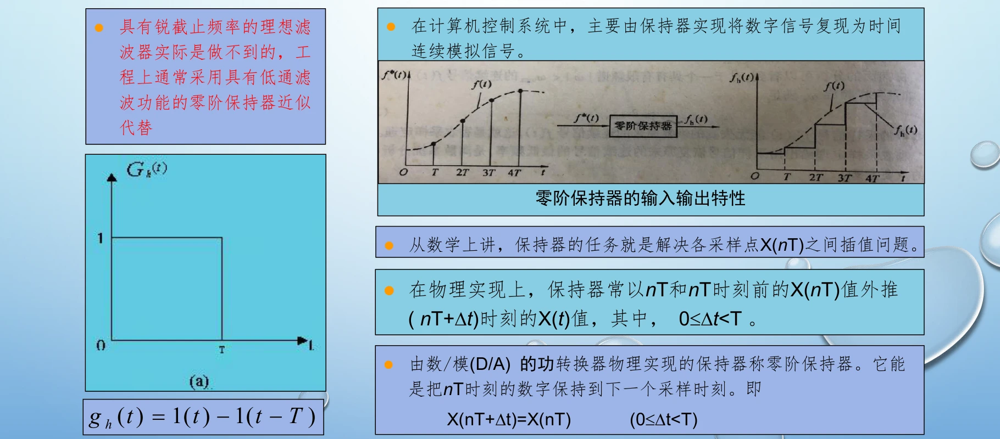

在第一频谱零点以内，相位滞后为 \(-\omega T/2\)；零点为 \(\omega=2n\pi/T\)，其中 n 为非零整数。低频时近似相当于半拍延迟，但不能据此忽略幅值变化。

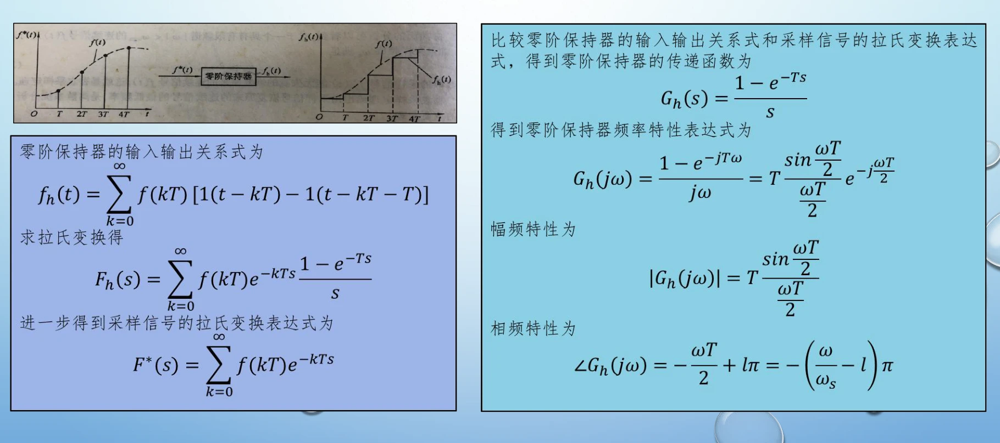

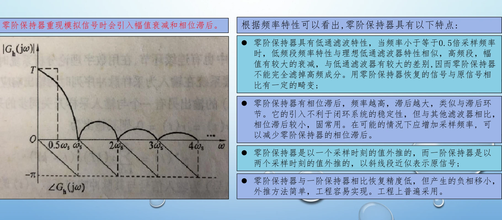

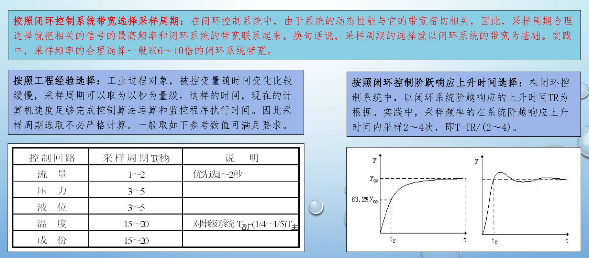

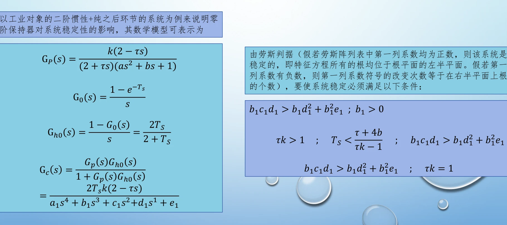

<!-- references:computer-control-chapter-02:2 -->

## 2.3 D/A 转换与 DAC0832 输出接口

D/A 转换把数字码按位权叠加，得到与输入码对应的模拟输出。电阻网络、模拟开关、基准源和运算放大器共同决定转换特性；位数决定理想分辨率，但不能单独代表实际精度。

复习性能指标时，要区分分辨率、转换误差、线性度与建立时间。给定基准和输入码后，应先确定单极性或双极性接法，再按电路关系计算输出，尤其检查极性和放大器的比例系数。

DAC0832 的关键是数据锁存与输出更新的配合。直通、单缓冲和双缓冲方式的区别在于何时接受总线数据、何时让转换结果生效。需要多个通道同步更新时，先锁存各路数据，再统一更新，不能把写数据和同步输出视为同一个动作。

分析接口题可按“数据从哪里来 → 片选和写信号如何使能 → 哪一级锁存器更新 → 模拟电流怎样转换成电压”顺序进行；引脚时序和完整接线在下面与计算例题一起核对。

### 位权叠加与输出换算

令 N 位码的整数值为 d、各位为 \(b_i\)，则数字量先按位权展开。对于常见反相电流求和接法，输出极性由运放接线确定。

$$
\begin{gathered}
d=\sum_{i=0}^{N-1}b_i2^i,\qquad
U_o=-\frac{R_f}{R}U_{\rm ref}\frac d{2^N}
\end{gathered}
$$

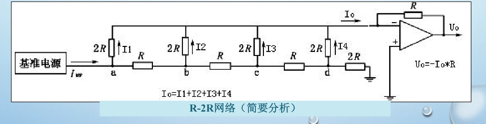

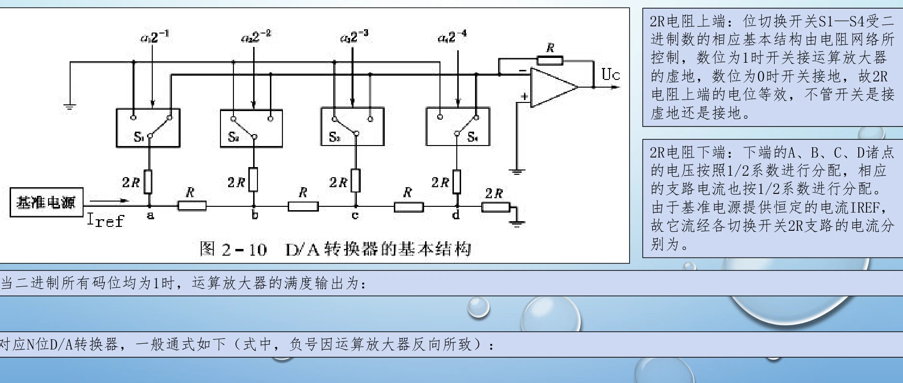

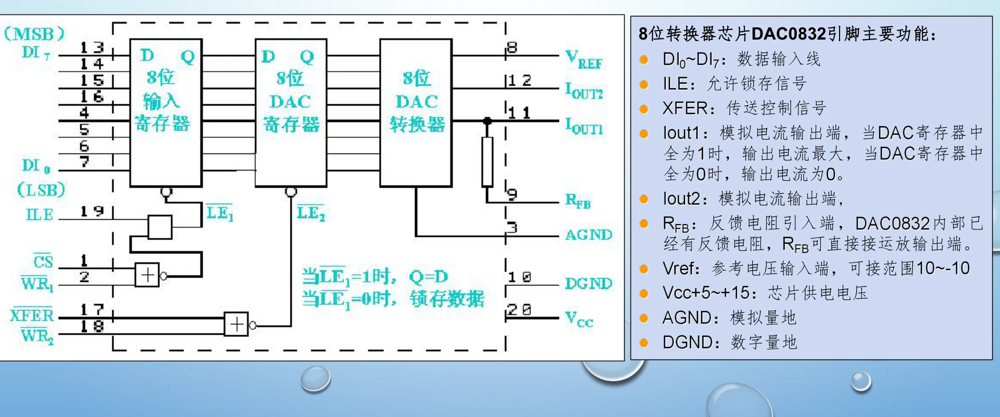

### 例题：要求输出约 1.5 V，应写入什么码？

课件接口例采用正向 0～5 V 的输出关系。目标 1.5 V 对应 76.8，取最近整数 77，即十六进制 4D。这里的正号来自该例的实际接线，不能直接套到上面的反相求和式。

$$
\begin{gathered}
d=\operatorname{round}\!\left(\frac{1.5}{5}256\right)=77,
\qquad U_o=5\frac{77}{256}=1.50390625\ \mathrm V
\end{gathered}
$$

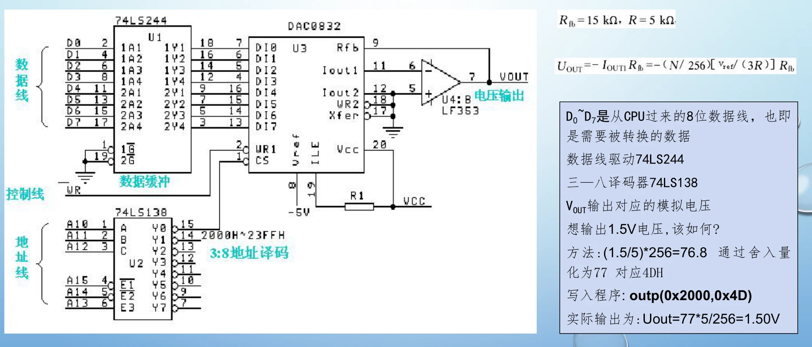

### 三种工作方式放在同一个更新过程里理解

直通方式让输入直接参与转换；单缓冲方式锁存一次写入；双缓冲方式先装入数据，再统一更新输出。对照接线图时，重点看数据锁存与 DAC 锁存的使能条件。

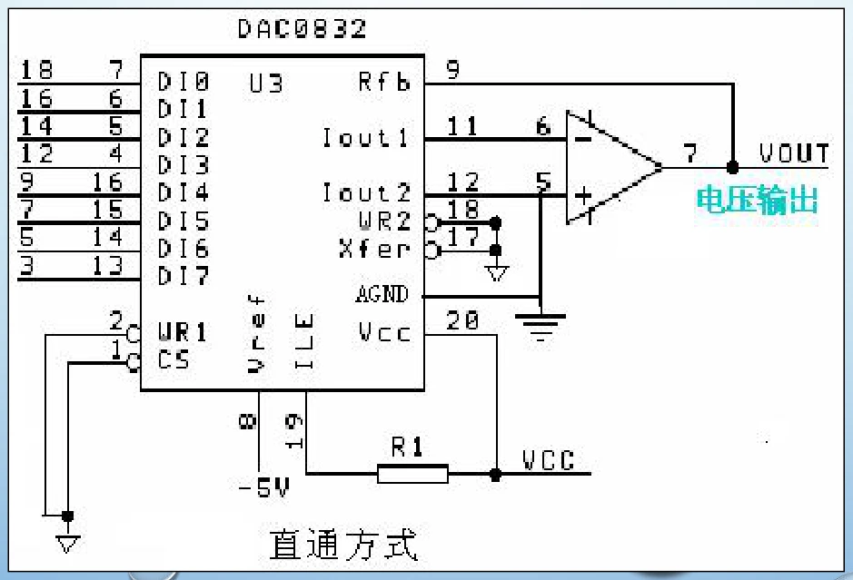

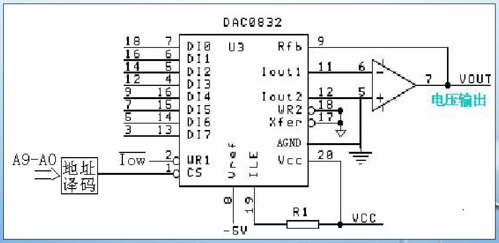

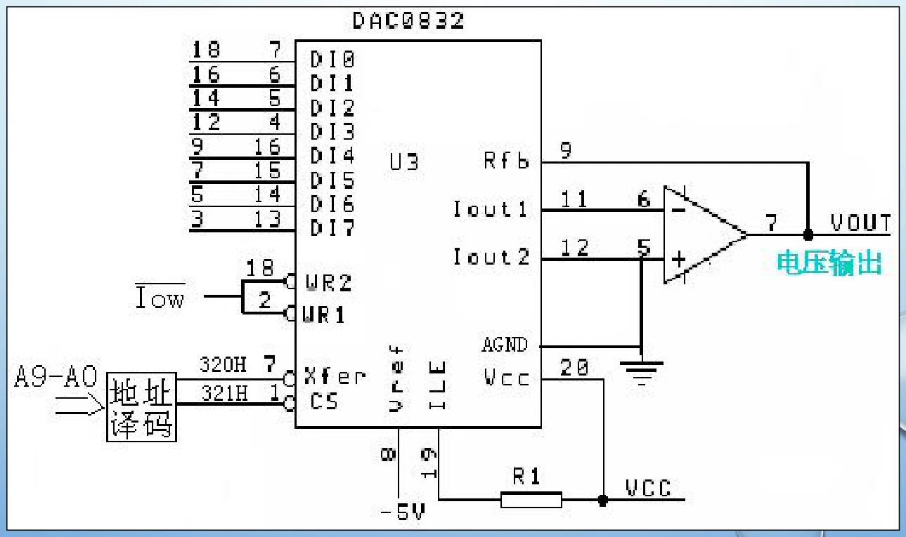

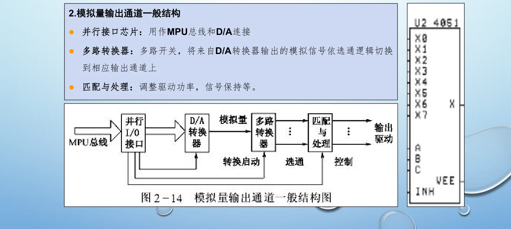

<!-- references:computer-control-chapter-02:3 -->

## 2.4 A/D 转换与 ADC0809 输入接口

A/D 转换把模拟输入变成数字码，典型过程包括取样、保持、量化和编码。逐次逼近式通过比较和逐位试探完成转换；双积分式借助积分过程实现转换，具有不同的速度、精度与抗干扰特点，比较时应结合实际任务。

ADC0809 的接口分析包括通道选择、启动转换、等待转换完成和读取结果四步。地址线选择输入通道，启动信号发起转换，EOC 等状态信号用于判断转换过程，输出允许信号使结果送上总线。不能在转换尚未完成时把总线上读到的数据当作新结果。

输入多路选择、前级信号调理、基准电压和转换时钟都会影响测量。量程换算应先由码值求输入电压，再根据传感器和调理电路的关系求被测物理量，最后检查单位、零点与满量程。

**把接口问题与控制时序合并看：** A/D 转换和数据读取必须在采样任务允许的时间内完成；采样周期、转换时间和程序执行时间不是同一个概念。

### 逐次逼近与双积分的计算关系

逐次逼近从最高位试探：若试探电压不超过输入，就保留该位，否则清除，再试下一位。课件例为 4 位、步距 0.25 V、输入 1.8 V；按从高位逐次比较得到 0111，即 1.75 V。

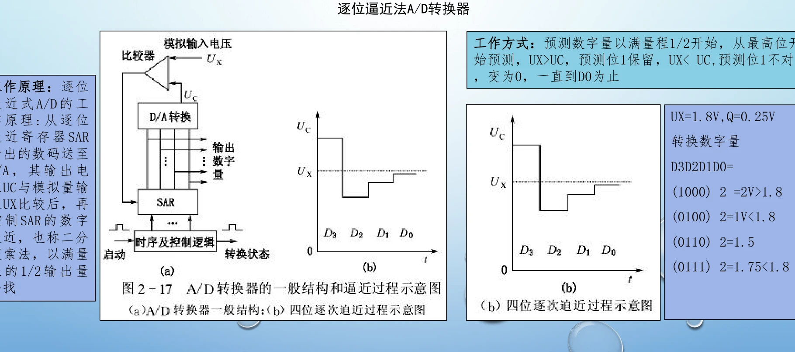

双积分先对未知输入积分固定时间，再用反向基准电压把积分器拉回零。理想条件下，两段积分面积相等：

$$
\begin{gathered}
|U_x|T_1=|U_{\rm ref}|T_2,\qquad
|U_x|=|U_{\rm ref}|\frac{T_2}{T_1}
\end{gathered}
$$

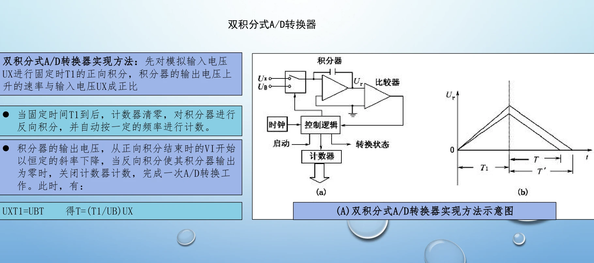

### ADC0809：接线、启动、等待、读数与量程换算

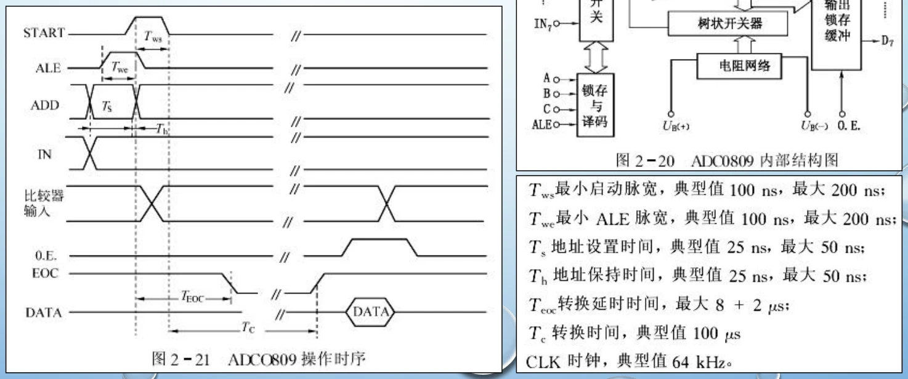

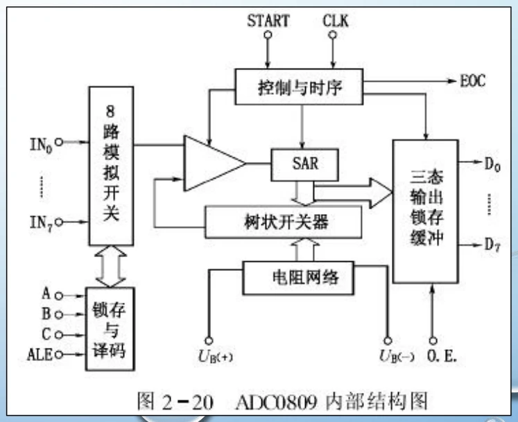

查询方式把 EOC 作为完成状态读取；中断方式由完成信号触发服务；定时等待方式必须覆盖所用时钟与器件条件下的转换时间。课件列出的等待数值不能脱离这些条件直接使用。启动后还要确认进入转换过程，避免把上一次的完成状态误当成本次结束。

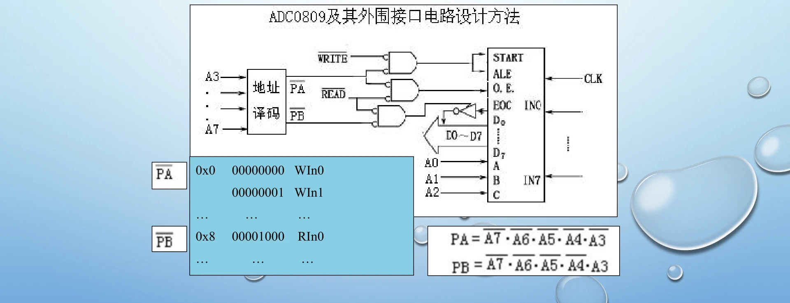

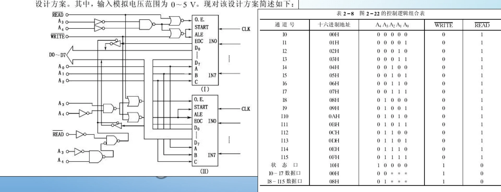

对于 8 位理想 ADC，令参考端电压为 \(V_+\)、\(V_-\)，码值为 d，常用的码宽换算如下。它表示码对应的输入等级，真实输入还存在量化区间和器件误差。

$$
\begin{gathered}
U_{\rm in}\approx V_-+\frac d{256}(V_+-V_-),\qquad 0\leq d\leq255
\end{gathered}
$$

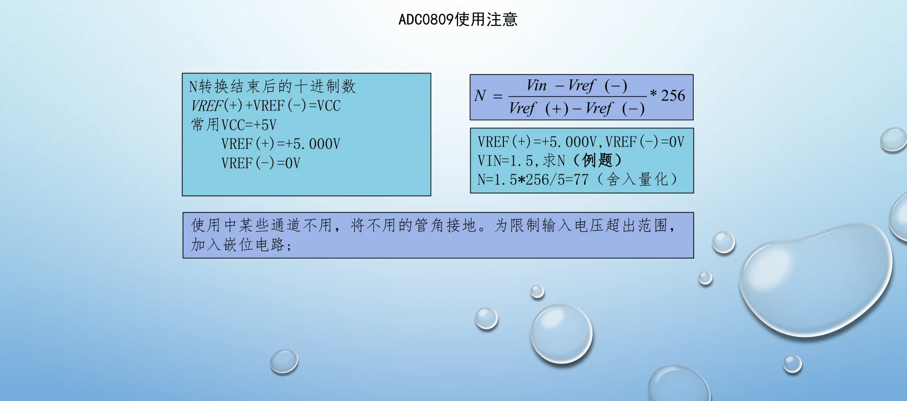

<!-- references:computer-control-chapter-02:4 -->

## 2.5 抗干扰、数字滤波与开关量接口

干扰需要同时有干扰源、传播通道和敏感对象。抑制方法可分别从源头减弱干扰、切断耦合路径和提高接收端抗扰能力入手；接地、屏蔽、隔离、布线与电源处理应与软件措施配合，而不能只靠事后滤波。

数字滤波要对应噪声特点选择：算术平均适合削弱随机波动；滑动平均持续更新窗口；中值滤波对孤立脉冲更有针对性；一阶惯性滤波用历史结果平滑新测量。窗口加大或平滑增强通常会增加响应滞后，可能影响闭环动态。

开关量输入关注电平匹配、隔离、抖动和有效状态识别；开关量输出关注驱动能力、保护以及实际执行状态。对继电器、接触器等感性负载，不能仅凭逻辑电平正确就认定接口设计完成。

复习这部分可围绕同一个问题：测量值为什么不可信、控制信号为什么没有正确执行？依次排查信号源、传输、接口、时序与处理程序，再决定是否采用滤波，避免把接线或采样错误掩盖在滤波结果中。

### 把几种数字滤波写成可计算的关系

下列统一用 x 表示原始测量，y 表示滤波结果，避免课件中同一个 y 同时表示原始值和结果。平均窗口为 M，权重和应为 1。

$$
\begin{gathered}
y[k]=\frac1M\sum_{i=0}^{M-1}x[k-i],\qquad
y[k]=\sum_{i=0}^{M-1}a_i x[k-i],\quad\sum_{i=0}^{M-1}a_i=1
\end{gathered}
$$

$$
\begin{gathered}
y[k]=\operatorname{median}\{x[k],x[k-1],x[k-2]\}
\\y[k]=\alpha y[k-1]+(1-\alpha)x[k],\qquad\alpha=\frac{T_f}{T+T_f}
\end{gathered}
$$

一阶滤波中，\(\alpha\) 越接近 1，平滑越强，响应通常也越慢。限速滤波不是普通的上下限裁剪：它比较本次原始值与上次接受值的变化。

$$
\begin{gathered}
y[k]=\begin{cases}x[k],&|x[k]-y[k-1]|\leq\Delta\\y[k-1],&|x[k]-y[k-1]|>\Delta\end{cases}
\end{gathered}
$$

### 干扰抑制与开关量连接

共模电压可以因两条输入路径不对称而转成差模误差。软件滤波处理不了错误接地或接口过压，应先排查硬件通路。

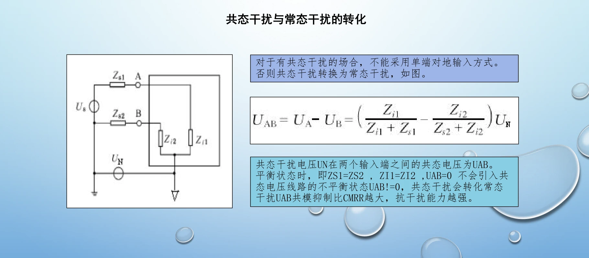

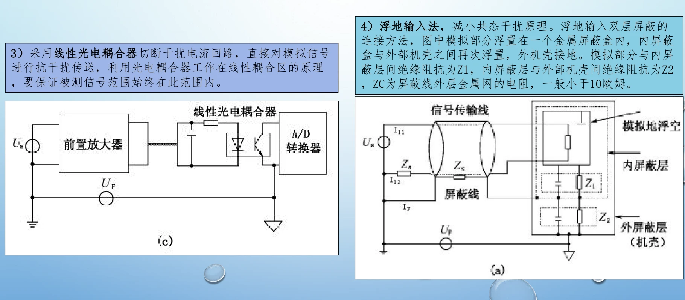

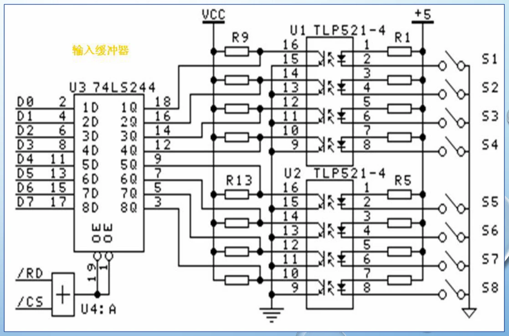

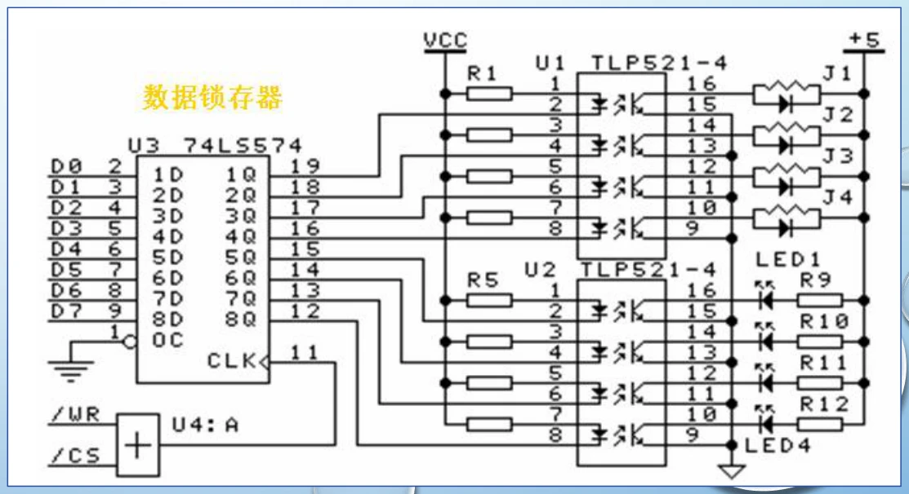

### 工程量换算

若传感器与调理电路在量程内为线性关系，先把码值还原为电压，再换成物理量。\(U_0,U_1\) 分别对应 \(X_0,X_1\)，应检查单位以及输入是否超量程。

$$
\begin{gathered}
X=X_0+\frac{U-U_0}{U_1-U_0}(X_1-X_0)
\end{gathered}
$$

<!-- references:computer-control-chapter-02:5 -->

## 2.6 Z 变换、常用性质与逆变换

Z 变换把离散序列转换到复频域。单边形式为 \(X(z) = \sum  x[k]z^(-k)\)，求和从 k = 0 开始。它使线性差分关系转化为代数关系，是后续建立脉冲传递函数和设计数字控制器的基础。

常用求解方法包括直接求和、部分分式和留数等方法。使用线性、时移、复微分、初值和终值性质时，必须核对变换采用的定义以及初始条件；单边变换处理时移时，不能忽略初始项。

逆变换的目标是从 X(z) 恢复 x[k]。对于有理式，先化成适合的标准形式，再按已知变换对或部分分式展开求序列。验算可检查前几个样值和差分方程是否一致。

**易错点：** z⁻¹ 表示一个采样周期的延迟；不是连续微分算子 s 的直接替代。终值定理也不能对任意不稳定或持续振荡序列直接套用，应先检查极点条件。

### 从定义到常用变换对

以下采用单边 Z 变换，序列从 k=0 开始；\(\delta[k]\) 是单位脉冲序列。收敛域须同时给出或由因果性确定。

$$
\begin{gathered}
X(z)=\sum_{k=0}^{\infty}x[k]z^{-k}
\\\delta[k]\ \longleftrightarrow\ 1,\qquad 1\ \longleftrightarrow\ \frac1{1-z^{-1}}
\\a^k\ \longleftrightarrow\ \frac1{1-az^{-1}},\qquad kT\ \longleftrightarrow\ \frac{Tz^{-1}}{(1-z^{-1})^2}
\\(kT)^2\ \longleftrightarrow\ \frac{T^2z^{-1}(1+z^{-1})}{(1-z^{-1})^3}
\end{gathered}
$$

例如 \(x[k]=e^{-akT}\)，直接把等比级数的公比取成 \(e^{-aT}z^{-1}\)，即可求和。对连续有理式作部分分式展开时，简单极点项 \(A_i/(s-p_i)\) 的采样对应 \(A_i/(1-e^{p_iT}z^{-1})\)，重极点则要保留相应的时间因子。

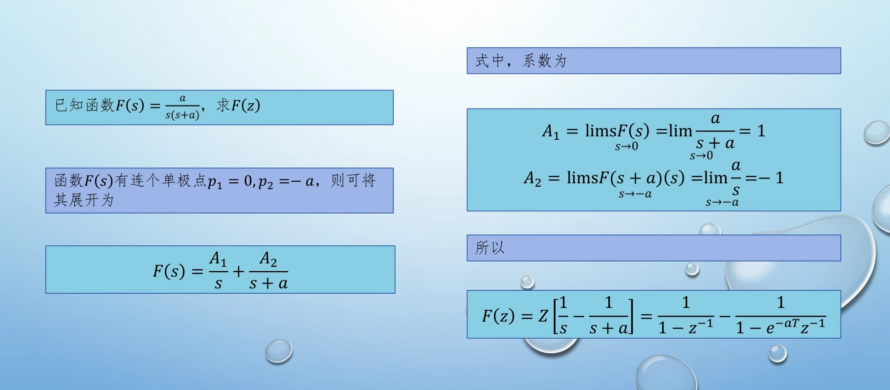

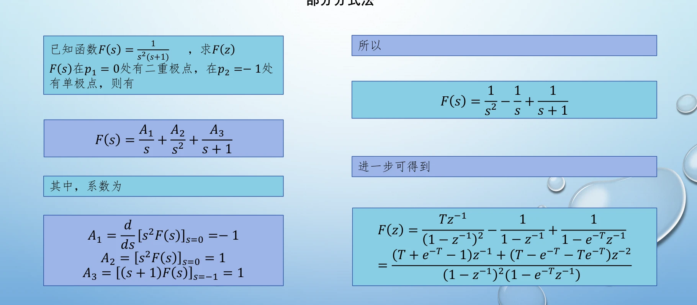

### 时移、复移、微分、卷积与初终值

单边变换的超前移位带有初始项。只有明确负时刻为零时，延迟一拍才可直接写为乘 \(z^{-1}\)。

$$
\begin{gathered}
\mathcal Z\{x[k+1]\}=z\bigl(X(z)-x[0]\bigr)
\\\mathcal Z\{x[k-m]\}=z^{-m}X(z)\quad\text{（零初始延迟）}
\\\mathcal Z\{a^kx[k]\}=X(z/a),\qquad\mathcal Z\{kx[k]\}=-z\frac{dX}{dz}
\\\mathcal Z\!\left\{\sum_{i=0}^kx[i]h[k-i]\right\}=X(z)H(z)
\\x[0]=\lim_{z\to\infty}X(z),\qquad x[\infty]=\lim_{z\to1}(1-z^{-1})X(z)
\end{gathered}
$$

终值公式需要 \((1-z^{-1})X(z)\) 的极点都在单位圆内，不能对振荡或发散序列直接套用。复积分性质可由定义逐项求导、再从 z 积分到无穷远得到。对于 k=0 的项，必须单独保留极限值。
若 \(x[k]=f(kT)\)，令 \(g[k]=f(kT)/(kT)\)（k≥1），且 \(g[0]=\lim_{t\to0}f(t)/t\) 有限，则：

$$
\mathcal Z\{g[k]\}=\frac1T\int_z^\infty\frac{X(\zeta)}{\zeta}\,d\zeta+g[0]
$$

### 逆变换例题：先改写为延迟形式，再展开

$$
\begin{gathered}
X(z)=\frac z{z-0.5}=\frac1{1-0.5z^{-1}}
=1+0.5z^{-1}+0.25z^{-2}+\cdots
\\x[k]=(0.5)^k,\quad k\geq0
\end{gathered}
$$

同一道题也可用部分分式或留数求解。对于重极点，不能把系数都当成简单极点的留数。

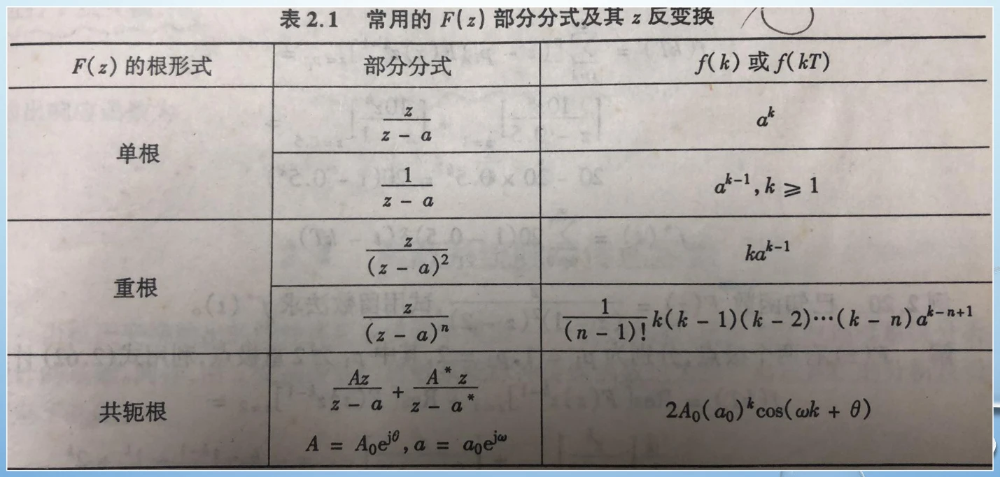

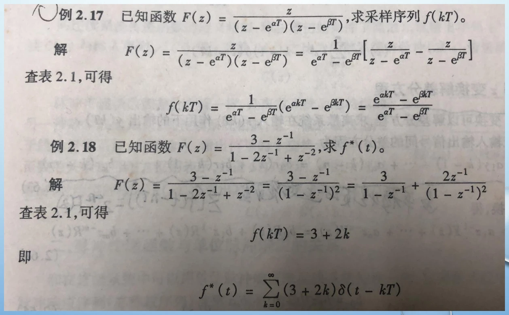

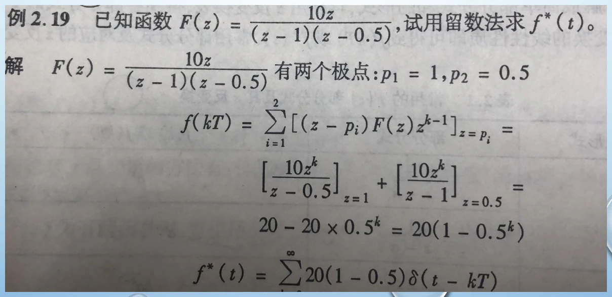

<!-- references:computer-control-chapter-02:6 -->
