# 第 3 章 · 离散系统分析与控制器实现

> 第 3 章 · 离散系统分析与控制器实现

## 3.1 脉冲传递函数与输入输出关系

脉冲传递函数描述线性离散系统在零初始条件下，输出样值序列与输入样值序列的变换比：\(G(z) = Y(z)/U(z)\)。它概括的是采样时刻的输入输出关系，不直接给出两个采样时刻之间的连续轨迹。

由差分方程求 G(z) 时，先按统一的 Z 变换规则处理各个时移项，再把输出项和输入项分别归并。反过来，由 G(z) 可以恢复差分方程，进而计算样值响应或编制控制程序。

闭环分析要明确每个信号的采样位置。只有串接环节之间满足相应离散信号连接条件时，才能按离散传递函数相乘；一般不能把连续环节分别作 Z 变换后无条件相乘。

### 差分方程与脉冲传递函数是同一个关系的两种写法

$$
\begin{gathered}
y[k]+\sum_{i=1}^na_i y[k-i]=\sum_{j=0}^m b_j u[k-j]
\\G(z)=\frac{\sum_{j=0}^m b_jz^{-j}}{1+\sum_{i=1}^na_i z^{-i}}\quad\text{（零初始条件）}
\end{gathered}
$$

### 例题：由传递函数算单位脉冲响应

课件给定如下二阶系统。先把分子分母同除以 \(z^2\)，再恢复递推式；负时刻输出均为零，输入为 \(\delta[k]\)。

$$
\begin{gathered}
G(z)=\frac{0.2386z}{z^2-0.9744z+0.2231}
=\frac{0.2386z^{-1}}{1-0.9744z^{-1}+0.2231z^{-2}}
\\y[k]=0.9744y[k-1]-0.2231y[k-2]+0.2386\delta[k-1]
\\y[0]=0,\quad y[1]=0.2386,\quad y[2]\approx0.2325,
\quad y[3]\approx0.1734,\quad y[4]\approx0.1171
\end{gathered}
$$

长除法得到的系数就是这些脉冲响应样值。一般输入下，则用输入序列与脉冲响应卷积：

$$
\begin{gathered}
y[k]=\sum_{i=0}^{k}g[i]u[k-i]
\end{gathered}
$$

<!-- references:computer-control-chapter-03:1 -->

## 3.2 带零阶保持器的连续对象离散化

实际数字控制器常通过零阶保持器驱动连续对象。求离散对象模型时，应把保持器与连续对象共同考虑，再在采样时刻取样；这与单纯对连续传递函数替换变量不同。

对连续对象 Gₚ(s)，常见的零阶保持等效关系写作 \(G(z) = (1 - z^{-1}) Z{L^{-1}[Gₚ(s)/s] 在 t=kT 的样值}\)。计算时先求连续对象的阶跃响应，再取样和变换，最后检查延迟阶次与稳态增益。

保持等效模型适用于控制量在每个采样周期保持不变的假设。若实际输出更新方式、计算延迟或接口时序不同，应把这些因素一并纳入模型，不能把离散化公式当作与实现无关的固定操作。

### 保持器必须并入连续对象后再取样

设连续对象为 \(G_p(s)\)，单位阶跃响应为 \(s_p(t)=\mathcal L^{-1}\{G_p(s)/s\}\)。零阶保持的等效离散对象可由阶跃响应样值之差求得：

$$
\begin{gathered}
G(z)=(1-z^{-1})\mathcal Z\{s_p(kT)\}
\end{gathered}
$$

这个写法明确了“先求连续阶跃响应，再在 kT 取值”。它不等于把连续传递函数中的 s 直接换成 z，也不等于无条件把两个环节各自的 Z 变换相乘。

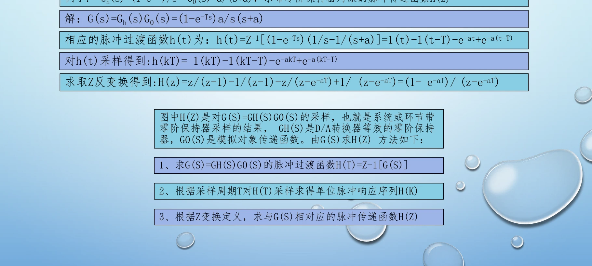

### 一阶惯性对象的完整计算

令 \(G_p(s)=K/(\tau s+1)\)，则 \(s_p(t)=K(1-e^{-t/\tau})\)。记 \(a=e^{-T/\tau}\)，代入上式并合并分母：

$$
\begin{gathered}
G(z)=(1-z^{-1})K\left[\frac1{1-z^{-1}}-\frac1{1-az^{-1}}\right]
=\frac{K(1-a)z^{-1}}{1-az^{-1}}
\\y[k]=ay[k-1]+K(1-a)u[k-1]
\end{gathered}
$$

<!-- references:computer-control-chapter-03:2 -->

## 3.3 时延系统与改进 Z 变换

时延要分成采样周期的整数倍部分和不足一个周期的部分。若延迟正好为 mT，对样值序列通常表现为 m 拍延迟，在 Z 域对应 z⁻ᵐ；不足一拍的延迟不能直接四舍五入成整数拍。

课件用改进 Z 变换处理非整数采样时延。其要点是保持连续响应、延迟和取样位置的先后关系，再得到离散描述。与没有延迟的对象相比，时延会改变响应出现的时刻，并可能增加控制设计难度。

做题时应先写清 T、时延 τ 以及两者的关系，再画出输入变化、保持输出和对象响应的时间轴；最后检查模型是否在真实响应开始以前就产生了输出。

### 先把延迟分成整拍和不足一拍

若延迟 \(\tau_d=mT\)，m 为非负整数，则整拍延迟直接对应 \(z^{-m}\)。这只对延迟与采样周期为整数倍的情况成立。

$$
\begin{gathered}
G_d(z)=z^{-m}G_0(z),\qquad y_d[k]=y_0[k-m]
\end{gathered}
$$

若 \(\tau_d=mT+\theta T\)、\(0<\theta<1\)，剩余部分改变取样在连续响应中的位置，不能把它写成“延迟半个数组下标”。改进 Z 变换的参数必须和采用的样点定义一致。

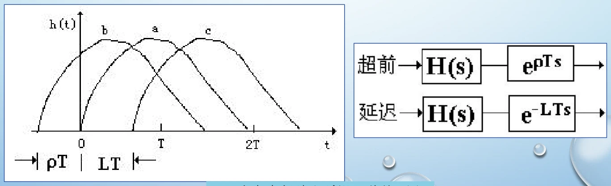

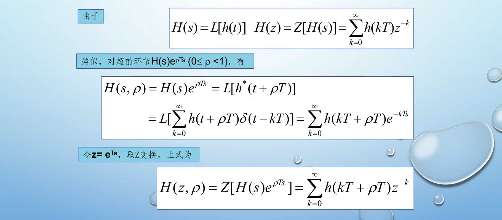

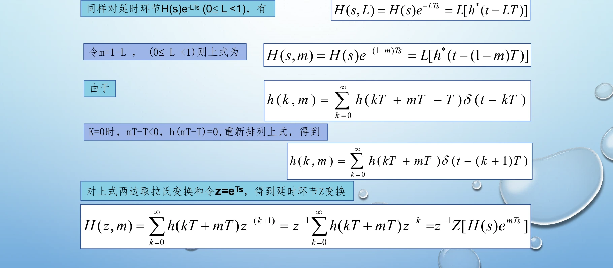

<!-- references:computer-control-chapter-03:3 -->

## 3.4 s 平面与 z 平面的映射

连续模态在取样后满足 \(z=e^{sT}\)。因此，连续系统左半平面的模态映射到单位圆内部，虚轴映射到单位圆上，右半平面映射到单位圆外；这是连续稳定性与离散稳定性联系的基础。

映射同时说明采样会带来频率等价现象：不同连续频率可能对应相同的离散角频率，所以不能仅凭离散模型唯一恢复所有连续频率信息。

分析极点时要区分稳定性和动态性能。极点在单位圆内只说明相应离散模态衰减；离单位圆的位置、复极点角度和采样周期还决定实际时间尺度上的衰减速度与振荡特性。

### 稳定性由极点位置判断

$$
\begin{gathered}
s=\sigma+j\omega,\qquad z=e^{sT}=e^{\sigma T}e^{j\omega T}
\\|z|=e^{\sigma T},\qquad \arg z=\omega T\pmod{2\pi}
\end{gathered}
$$

因此左半平面对应单位圆内，虚轴对应单位圆，右半平面对应单位圆外。同一离散极点可以对应相差整数倍采样角频率的连续频率；这是多对一映射。极点落在单位圆上时，还要区分简单极点、重极点和所讨论的稳定性，不能一概判为渐近稳定。

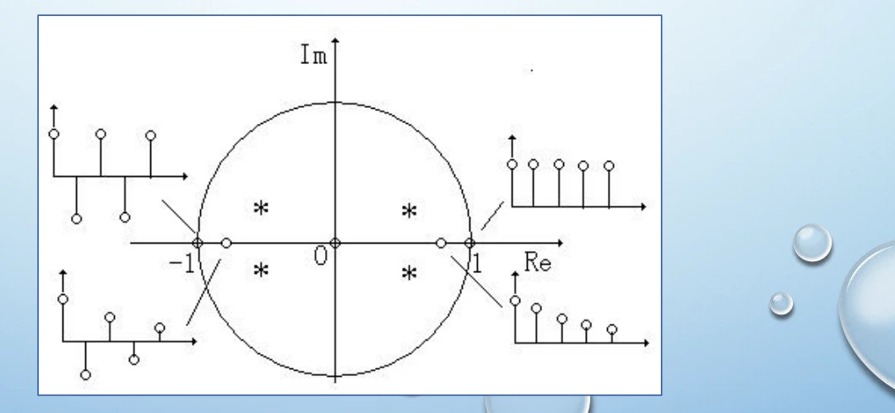

### 闭环计算例题：同一对象改变采样周期

单位负反馈时，先求含保持器的离散对象，再与数字控制器组合。下面两幅把同一例题的条件、计算和采样周期对比放在一起。

$$
\begin{gathered}
\Phi(z)=\frac{D(z)G(z)}{1+D(z)G(z)},\qquad
\Phi_e(z)=\frac1{1+D(z)G(z)}
\end{gathered}
$$

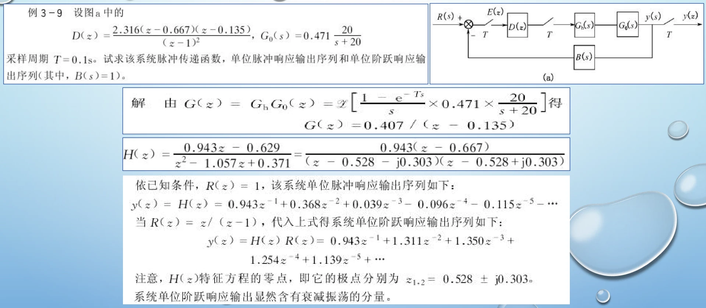

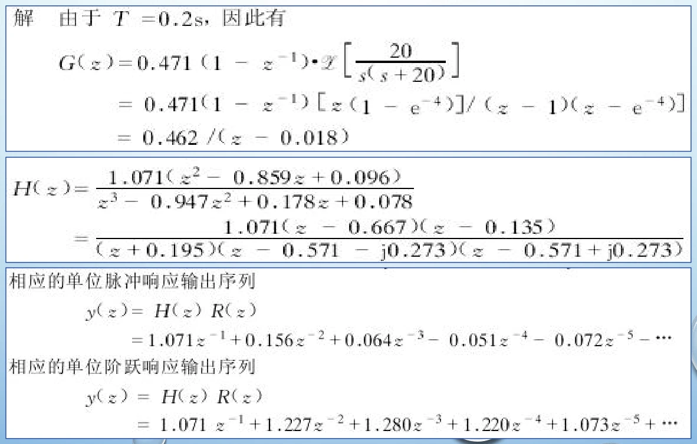

<!-- references:computer-control-chapter-03:4 -->

## 3.5 并联程序法与迭代程序法

同一个数字控制器可以有不同实现结构。并联程序法先将 D(z) 作适当的部分分式展开，让各支路分别响应同一输入，再将支路输出合成。其状态变量和递推关系来自各分式，而不是任意选取。

迭代程序法按控制器的因式或逐级递推关系安排运算，使前一级的状态或中间结果进入后一级。编程前要明确每一级的输入、输出以及使用当前值还是历史值，才能得到与设计一致的状态方程。

两种方法均应从传递函数推导状态方程与输出方程，再画编程框图。复核时用相同初值和输入计算前几拍响应，检查不同结构是否实现同一个理想控制器。

### 并联法：把不同极点对应的支路分开计算

简单极点部分分式可写为下式。各支路独立保存状态，再把输出相加。重极点不能拆成互不相关的相同简单支路，需要保留级联状态。

$$
\begin{gathered}
D(z)=d_0+\sum_i\frac{c_i}{z-p_i}
\\x_i[k+1]=p_i x_i[k]+e[k],\qquad
u[k]=d_0e[k]+\sum_i c_ix_i[k]
\end{gathered}
$$

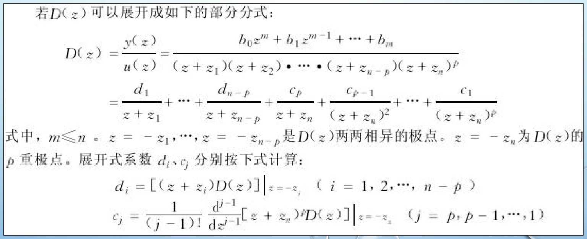

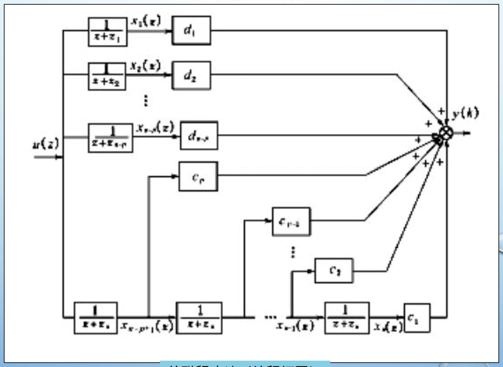

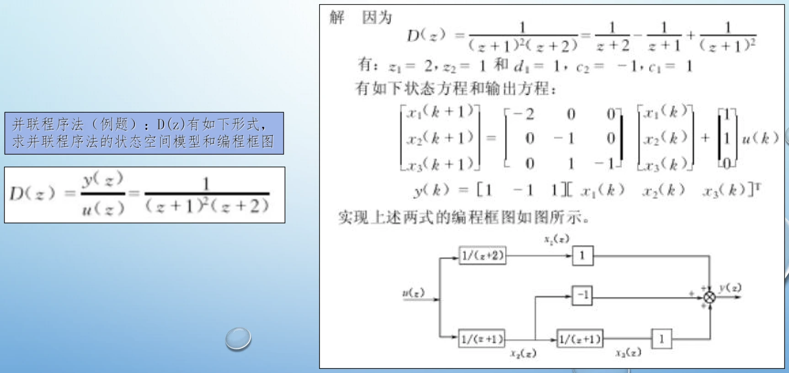

### 迭代法：按分解后的串联支路更新

迭代程序法把有理式逐步分解成可递推的环节。关键是按当前拍的依赖关系计算，不能把尚未更新的状态误作新状态。课件用下面这个二阶函数演示分解及程序框图。

$$
\begin{gathered}
D(z)=\frac{z^2+2z+1}{(z+2)(z+3)}
=1+\frac{-3z-5}{(z+2)(z+3)}
\end{gathered}
$$

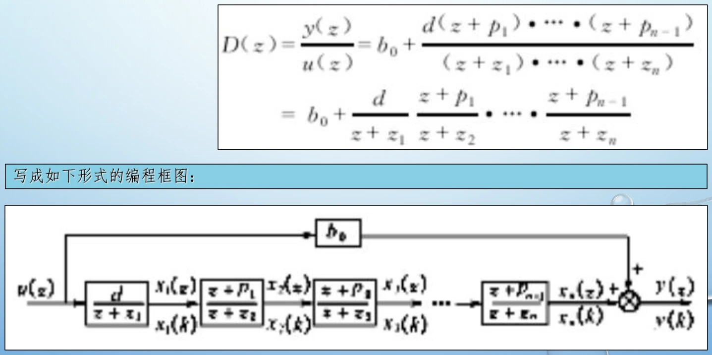

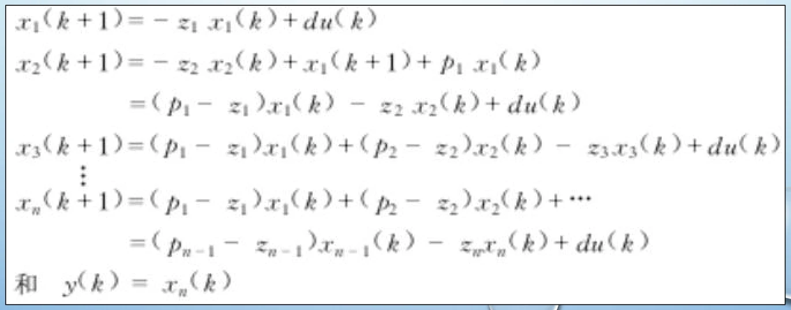

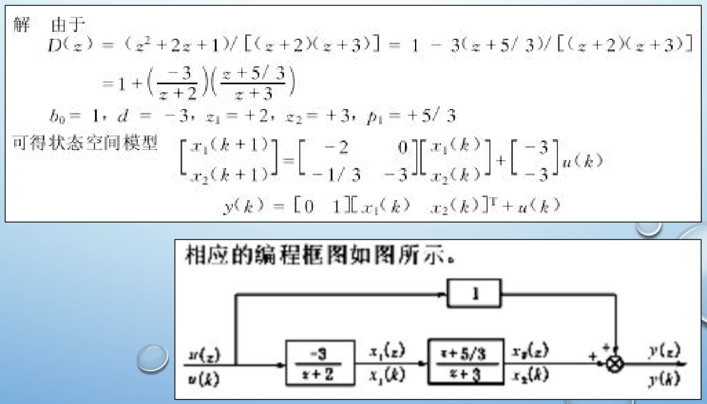

<!-- references:computer-control-chapter-03:5 -->

## 3.6 直接程序法、嵌套程序法与状态更新

把数字控制器写成 z⁻¹ 的有理式后，可以整理为递推关系。分母归一化后，当前输出由若干历史输出和当前、历史输入的加权和构成。直接程序法利用相应的延迟状态实现；嵌套程序法则将多项式逐层嵌套，得到另一种状态和运算组织方式。

程序应按“采集输入 → 读取历史量 → 计算当前输出 → 限幅或保护 → 更新历史量”的顺序执行。若在计算结束前覆盖旧状态，理论上正确的递推式也会被错误实现。

不同实现结构可能具有相同的理想传递函数，却有不同的存储需求和数值误差表现。实现题既要给出状态方程和输出方程，也要说明初始化、采样周期、数据类型和实际输出约束。

### 直接法：先统一成延迟多项式

$$
\begin{gathered}
D(z)=\frac{b_0+b_1z^{-1}+\cdots+b_nz^{-n}}{1+a_1z^{-1}+\cdots+a_nz^{-n}}
\\u[k]=-\sum_{i=1}^n a_i u[k-i]+\sum_{i=0}^n b_i e[k-i]
\end{gathered}
$$

上式直接给出可执行的差分关系。采用较少延迟单元的规范结构时，内部状态的定义会改变，不能把不同结构的状态名称混为同一个量。

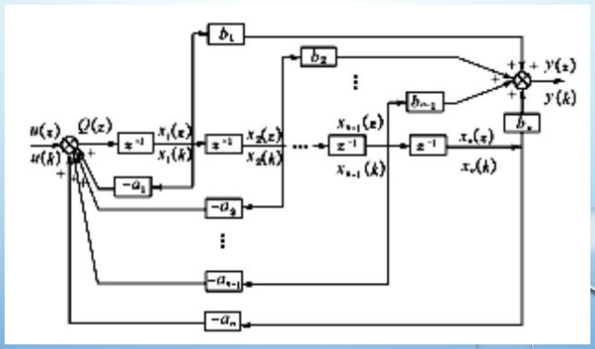

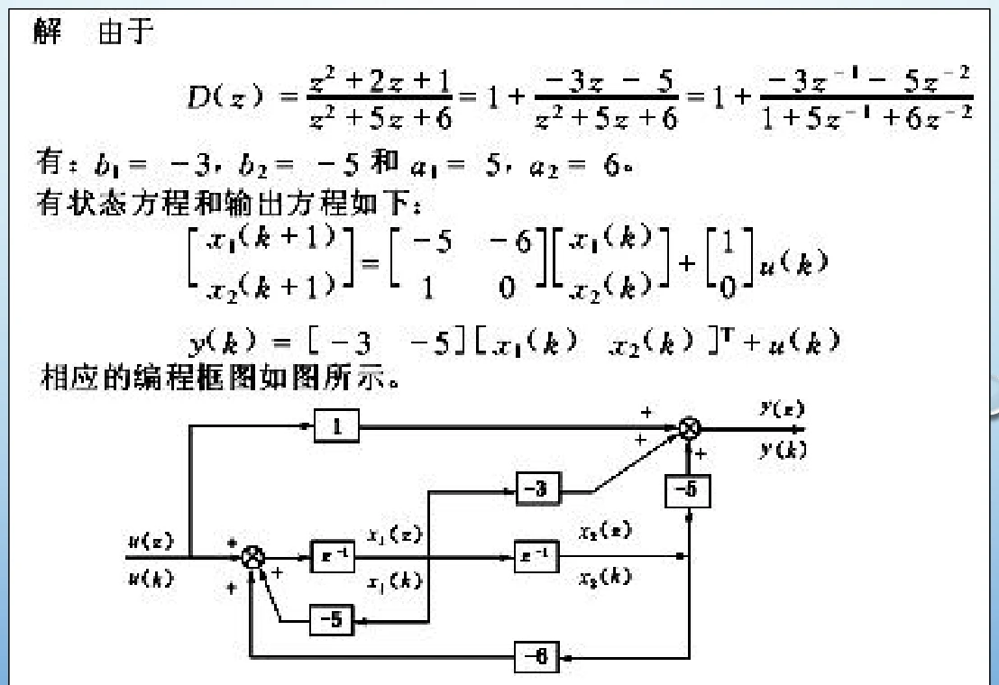

### 同一二阶例题的状态核对

对于上一节的 \(D(z)=(z^2+2z+1)/(z^2+5z+6)\)，一种直接规范实现为：

$$
\begin{gathered}
x[k+1]=\begin{bmatrix}-5&-6\\1&0\end{bmatrix}x[k]
+\begin{bmatrix}1\\0\end{bmatrix}e[k],\qquad
u[k]=\begin{bmatrix}-3&-5\end{bmatrix}x[k]+e[k]
\end{gathered}
$$

这里输出中的直通项是 1，不能因分子和分母同阶而漏掉。例题极点为 −2、−3，它用于比较实现结构，不是一个稳定调节器的示范。

### 嵌套法与更新顺序

嵌套法把延迟多项式逐层展开，形成另一种状态组织方式。计算当前输出时使用上一拍保存的状态，然后统一保存新状态；若顺序覆盖了仍需使用的旧值，应使用临时变量。

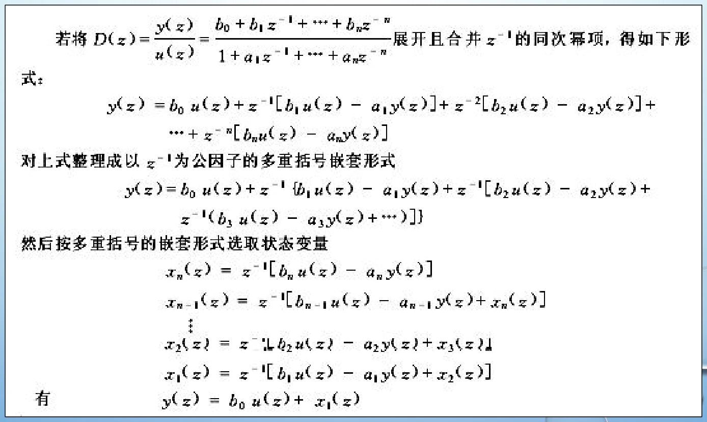

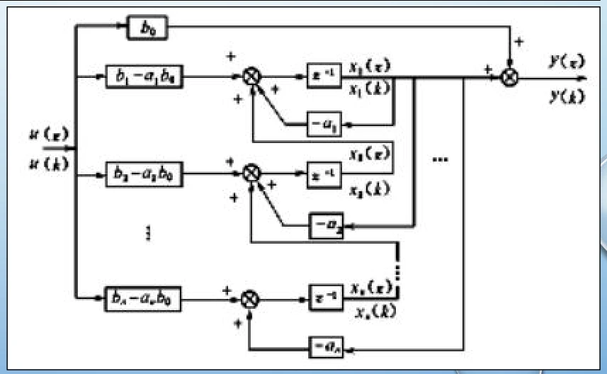

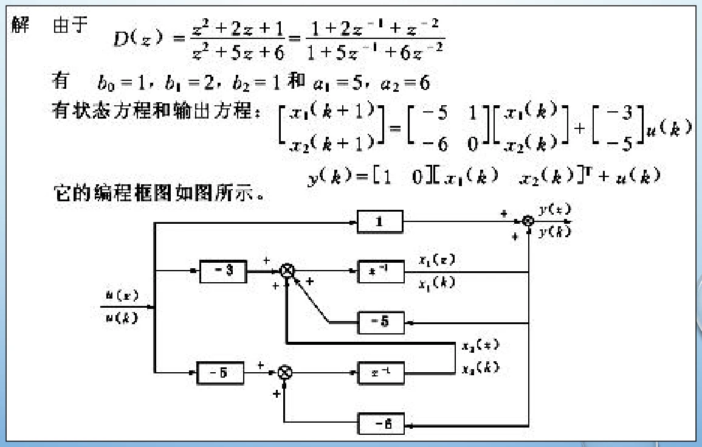

<!-- references:computer-control-chapter-03:6 -->

## 3.7 有限字长与数值实现误差

计算机只能用有限位数存储系数、输入和中间结果，所以实际控制器与无限精度模型之间会存在偏差。主要问题包括输入量化、系数量化、运算舍入或截断，以及定点运算的溢出。

系数量化可能移动极点；中间结果的尺度过大可能溢出；过小则可能损失有效分辨率。即使外部输入很小，某些递推实现也可能表现出与量化有关的振荡，因此需要结合结构和数值范围检查。

可采取合适的字长、缩放、运算结构和饱和处理来减轻问题，但不能只把所有变量换成更高位数就忽略闭环稳定性与执行器约束。复习时应把“理想设计正确”和“有限精度实现可用”作为两个相互关联的问题。

### 量化误差怎样传到输出

先统一误差符号。本节用量化后减量化前定义误差。若舍入误差在 \([-q/2,q/2]\) 内均匀分布，均值为 0、方差为 \(q^2/12\)；若采用向下截断，误差区间为 \((-q,0]\)，均值为 \(-q/2\)。对负数采用其他截断规则时要重新判断。

$$
\begin{gathered}
\mathrm E[e_q]=0,\qquad \sigma_e^2=\frac{q^2}{12}\quad\text{（均匀舍入模型）}
\\\mathrm E[y_q]=H(1)\mathrm E[e_q],\qquad
\sigma_y^2=\sigma_e^2\sum_{i=0}^{\infty}h[i]^2
\end{gathered}
$$

输出方差公式假定量化误差可近似为不相关、同方差的白噪声，并且系统稳定；强相关、溢出和极限环情况下不能照搬。

对 \(H(z)=1/(1-az^{-1})\)、\(|a|<1\)，\(h[k]=a^k\)，所以：

$$
\begin{gathered}
\sigma_y^2=\frac{\sigma_e^2}{1-a^2}
\end{gathered}
$$

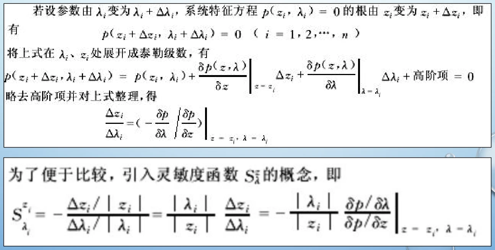

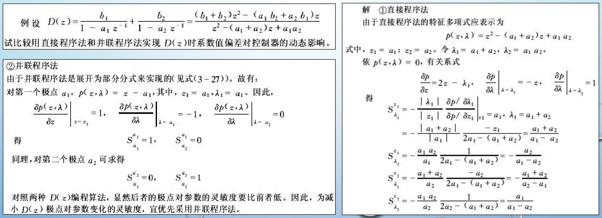

<!-- references:computer-control-chapter-03:7 -->
