# 第 4 章 · 模拟调节器离散化与数字 PID

> 第 4 章 · 模拟调节器离散化与数字 PID

## 4.1 模拟调节器的离散化方法

模拟调节器离散化是先设计连续控制规律，再构造能由数字程序实现的近似。差分法用相邻样值近似微分，数值积分法用矩形或梯形面积近似积分，关键是明确近似发生在哪一个运算环节。

常见替换包括后向差分 \(s ≈ (1 - z^{-1})/T\) 和双线性变换 \(s ≈ (2/T)(1 - z^{-1})/(1 + z^{-1})\)。后向差分和双线性变换具有各自的映射特性；双线性变换会引入频率畸变，不能把连续与离散频率直接一一按数值相等处理。

离散化后应把 D(z) 整理为递推形式，并比较采样周期变化对误差、响应速度和稳定性的影响。方法的选择要结合设计关注的频段、计算条件和允许误差，而不是只比较公式长短。

### 三种替换要连同近似依据一起记

前向差分把当前区间的导数近似为前后样值之差；后向差分使用当前及上一拍；梯形积分则把每段面积近似为两端值的平均。

$$
\begin{gathered}
s\approx\frac{z-1}{T}\quad\text{前向差分},\qquad
s\approx\frac{1-z^{-1}}T\quad\text{后向差分}
\\s\approx\frac2T\frac{1-z^{-1}}{1+z^{-1}}\quad\text{双线性变换}
\end{gathered}
$$

前向差分不能无条件保留稳定性；后向差分与双线性变换把连续稳定极点映入单位圆内。双线性变换的频率关系如下；\(\Omega\) 为每拍弧度，\(\omega\) 为连续角频率。

$$
\begin{gathered}
\omega=\frac2T\tan\frac\Omega2
\end{gathered}
$$

### 例题：后向差分法从代入到递推

课件取 \(D(s)=2/[(s+2)(s+3)]\)、\(T=0.5\ \mathrm s\)。记 \(q=z^{-1}\)，代入 \(s=2(1-q)\)：

$$
\begin{gathered}
D(z)=\frac2{(4-2q)(5-2q)}
=\frac{0.1}{1-0.9q+0.2q^2}
\\u[k]=0.9u[k-1]-0.2u[k-2]+0.1e[k]
\end{gathered}
$$

取单位阶跃输入、零初始条件，数字输出前四项为 0.1、0.19、0.251、0.2879。连续阶跃响应为下式，在 t=0 从 0 起步；二者在初始时刻已经存在差别。

$$
\begin{gathered}
u_c(t)=\frac13-e^{-2t}+\frac23e^{-3t}
\end{gathered}
$$

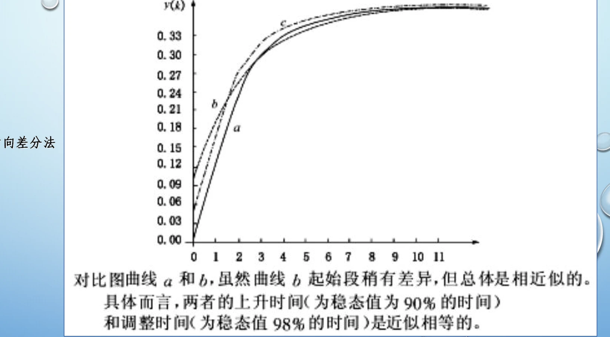

### 同一例题：双线性变换的完整结果

保持对象与采样周期不变，改用 \(s=4(1-q)/(1+q)\)。先保留分母因式，再展开，能减少系数算错。

$$
\begin{gathered}
D(z)=\frac{2(1+q)^2}{(6-2q)(7-q)}
=\frac{\frac1{21}+\frac2{21}q+\frac1{21}q^2}{1-\frac{10}{21}q+\frac1{21}q^2}
\\u[k]=\frac{10}{21}u[k-1]-\frac1{21}u[k-2]
+\frac1{21}e[k]+\frac2{21}e[k-1]+\frac1{21}e[k-2]
\end{gathered}
$$

<!-- references:computer-control-chapter-04:1 -->

## 4.2 离散等效设计与方法比较

离散等效设计关注怎样让数字控制器在某种意义下保留模拟调节器的特性。不同方法所匹配的对象不同：脉冲响应不变法匹配采样的脉冲响应，阶跃响应不变法匹配采样的阶跃响应，双线性变换则通过变量映射近似频率特性。

这些方法没有对所有指标都相同的“完全等效”。应先确定要保留的是时域响应、特定频段特性还是稳定性映射，再比较方法的适用条件。脉冲响应不变法还要注意频谱混叠以及连续模型形式的限制。

同一个 D(s) 经不同方法得到不同 D(z) 是正常现象。例题比较应使用相同对象与采样周期，检查阶跃响应、稳态增益、延迟和实现结构，不能只凭某一次曲线相近就断言一种方法普遍更好。

### 脉冲响应不变法与极零点匹配法

简单极点展开为 \(D(s)=\sum_i A_i/(s-p_i)\) 时，按课件不附加 T 的脉冲采样定义，有如下表达。部分教材会再乘 T，比较结果前必须先对齐这一约定。

$$
\begin{gathered}
D_i(z)=\sum_i\frac{A_i}{1-e^{p_iT}z^{-1}}
\end{gathered}
$$

对上一节相同的例题，部分分式系数为 2 和 −2，所以：

$$
\begin{gathered}
D_i(z)=2\left[\frac1{1-e^{-1}z^{-1}}-\frac1{1-e^{-1.5}z^{-1}}\right]
\end{gathered}
$$

极零点匹配先把有限极点、零点按 \(z=e^{sT}\) 对应，再按选定规则处理无穷远零点，并校正增益。课件此例把两个无穷远零点放在 z=−1，以匹配直流增益，得到：

$$
\begin{gathered}
D_m(z)=\frac1{12}(1-e^{-1})(1-e^{-1.5})
\frac{(z+1)^2}{(z-e^{-1})(z-e^{-1.5})}
\end{gathered}
$$

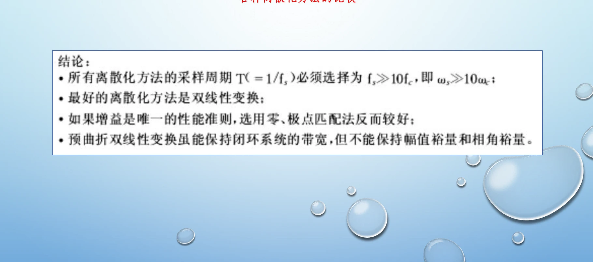

### 保持器与采样周期也属于等效设计

低频展开得到 \(H_0(s)/T\approx1-Ts/2\)，可近似为 \(1/(1+Ts/2)\)。如果在截止频率 \(\omega_c\) 允许保持器增加的相位滞后为 \(\varphi\)，则用半拍延迟近似可估算采样周期。

$$
\begin{gathered}
\frac{H_0(s)}T\approx\frac1{1+Ts/2},\qquad
\frac{\omega_cT}{2}\lesssim\varphi\quad\text{（}\varphi\text{用弧度）}
\end{gathered}
$$

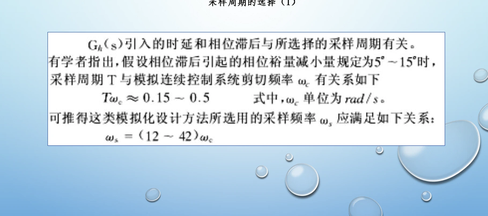

<!-- references:computer-control-chapter-04:2 -->

## 4.3 PID 的作用与位置式、增量式算法

PID 将当前偏差、偏差积累和偏差变化组合起来。比例作用使输出及时响应偏差；积分作用有助于消除特定输入下的稳态偏差，但可能增加超调并引起饱和累积；微分作用反映变化趋势，可能改善动态过程，同时会放大高频噪声。

一种常见离散位置式为 \(u[k] = K_p\cdot e[k] + K_i\cdot \sum e[j] + K_d\cdot (e[k]-e[k-1])\)。这里 Ki、Kd 已包含相应采样周期系数；若使用 Ti、Td 参数形式，应重新核对 T 的位置，不能把不同记号的参数直接互换。

相邻两拍位置式相减可得增量形式：\(\Delta u[k] = K_p(e[k]-e[k-1]) + K_i\cdot e[k] + K_d(e[k]-2e[k-1]+e[k-2])\)，再由 \(u[k]=u[k-1]+\Delta u[k]\) 更新。增量式仍需保存历史量，也不会自动消除执行器饱和问题。

做题时先统一偏差符号和参数定义，再选择形式，给出初始化与输出限制。比较两种算法时应谈状态保存、输出更新与实际执行方式，不宜简单说一种“必然更稳定”。

### 参数定义：先分清连续时间常数与离散系数

$$
\begin{gathered}
u(t)=K_p\left[e(t)+\frac1{T_i}\int_0^t e(\tau)\,d\tau
+T_d\frac{de(t)}{dt}\right]
\\K_i=K_p\frac T{T_i},\qquad K_d=K_p\frac{T_d}{T}
\end{gathered}
$$

这里 \(K_i,K_d\) 是已经包含采样周期的离散系数。积分用矩形累加、微分用后向差分时，位置式如下；\(u_b\) 表示初始偏置或积分初值折算的输出。

$$
\begin{gathered}
u[k]=u_b+K_pe[k]+K_i\sum_{j=0}^{k}e[j]+K_d(e[k]-e[k-1])
\end{gathered}
$$

相邻两拍相减就得到增量式，所以两种形式在参数、初值与限幅处理相同的理想条件下相对应。

$$
\begin{gathered}
\Delta u[k]=K_p(e[k]-e[k-1])+K_ie[k]
+K_d(e[k]-2e[k-1]+e[k-2])
\\u[k]=u[k-1]+\Delta u[k]
\end{gathered}
$$

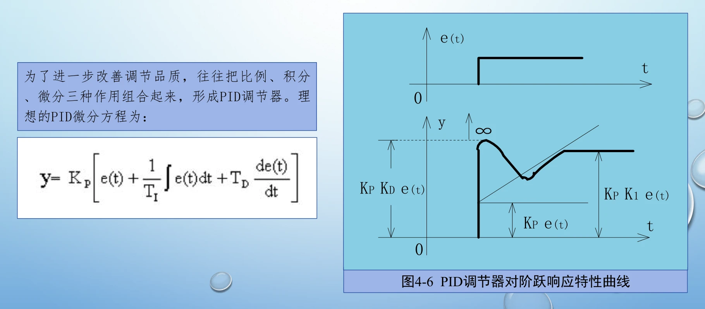

### 计算顺序与历史量

先读取测量并算偏差，再算比例、积分、微分，施加输出限制，最后保存本拍状态。增量式微分项需要当前偏差和前两拍偏差，共三项；这里不能误读成还要保留“此前三拍”。

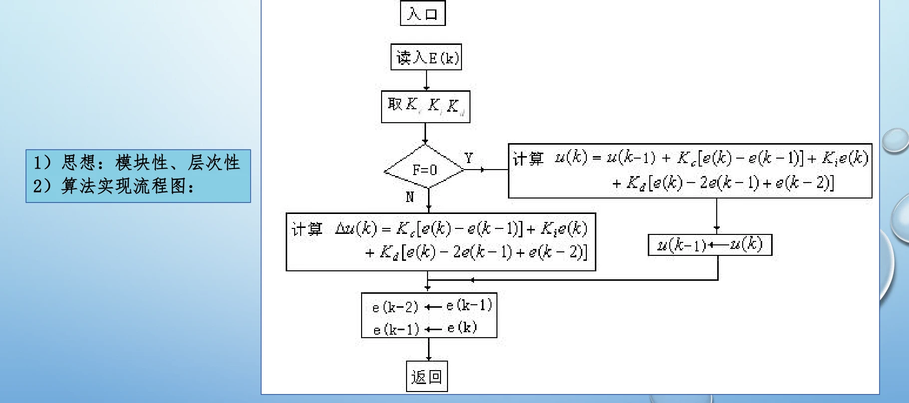

<!-- references:computer-control-chapter-04:3 -->

## 4.4 饱和效应、微分处理与 PID 改进

执行器存在上、下限。控制输出被限幅以后，如果积分仍不断累加，解除饱和时就可能出现恢复缓慢和明显超调，这就是积分饱和相关问题。处理时必须让积分状态与真实执行能力相协调。

常见思路包括在特定条件下暂停积分、积分分离和利用限幅前后差值修正积分状态。具体使用哪种方式，应根据对象和控制要求判断；增量式写法本身并不构成抗积分饱和措施。

微分环节常配合滤波以降低噪声影响，也可对测量量而不是给定值突变直接求微分，减轻设定变化引起的输出冲击。算法改进时要同时观察噪声、响应速度和限幅下的恢复，不能只看未饱和的小信号曲线。

### 限幅与积分状态必须协调

$$
\begin{gathered}
u[k]=\operatorname{clip}\bigl(u_{\rm raw}[k],u_{\min},u_{\max}\bigr)
\end{gathered}
$$

若输出已到上限而偏差仍推动积分继续增大，应停止这方向的积累；偏差开始使输出离开饱和时，应允许积分恢复。积分分离则在大偏差时关闭积分，小偏差时恢复；阈值与切换要结合实际对象。

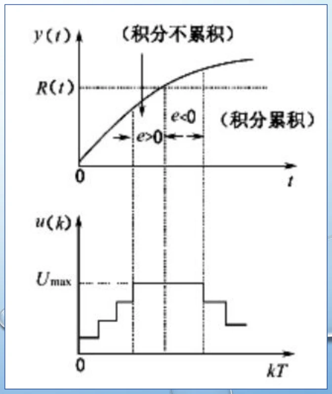

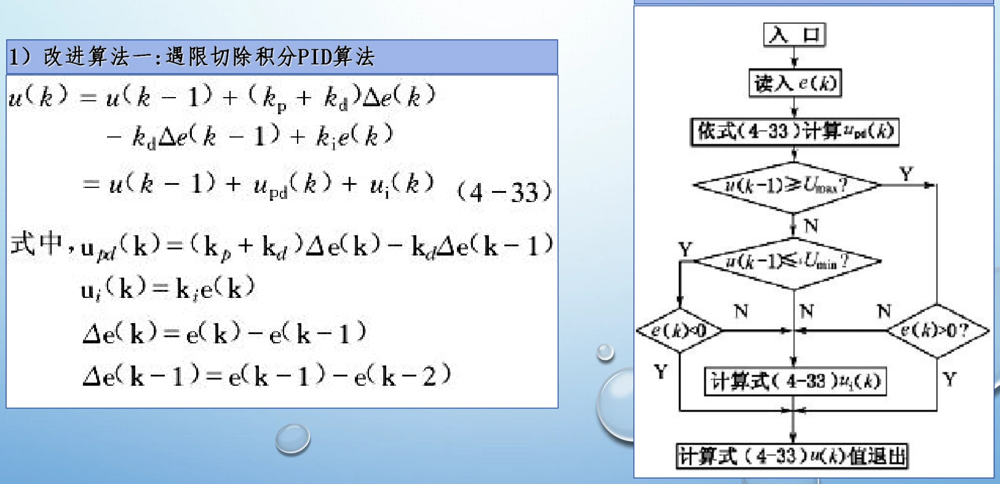

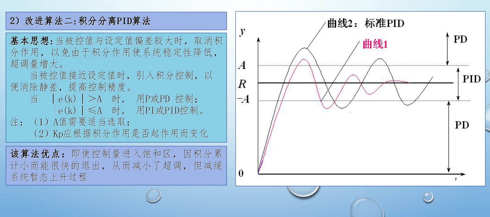

### 不完全微分、微分先行与其他改进

不完全微分给理想微分环节增加高频衰减。若对理想控制输出 \(u'[k]\) 再作一阶平滑，可写成：

$$
\begin{gathered}
u[k]=\alpha u[k-1]+(1-\alpha)u'[k],\qquad
\alpha=\frac{T_f}{T+T_f}
\end{gathered}
$$

微分先行把微分作用放在测量量上，避免给定值阶跃直接产生微分冲击。按本章偏差定义，位置式微分项为 \(-K_d(y[k]-y[k-1])\)，增量式对应：

$$
\begin{gathered}
\Delta u_d[k]=-K_d(y[k]-2y[k-1]+y[k-2])
\end{gathered}
$$

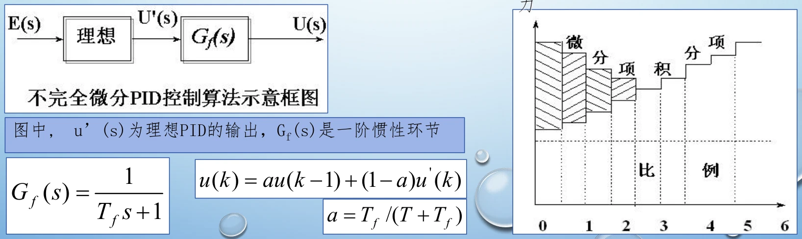

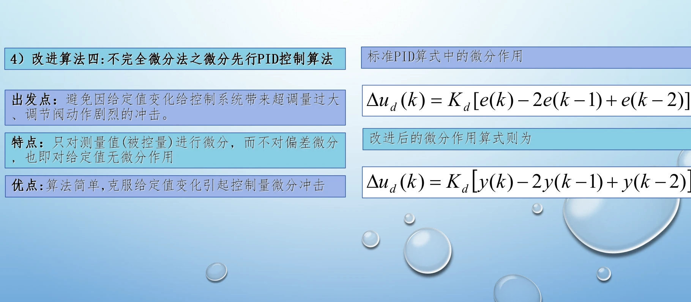

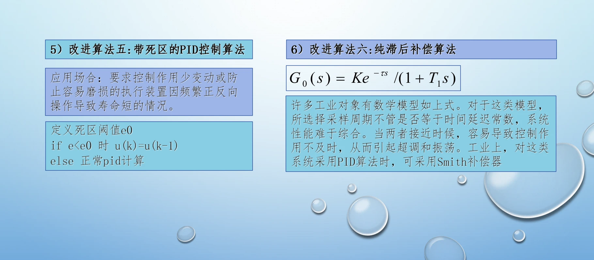

<!-- references:computer-control-chapter-04:4 -->

## 4.5 PID 参数整定与闭环检查

整定 PID 的目标是满足给定的稳定性、动态响应、稳态误差和控制输出要求。参数之间存在耦合，比例、积分、微分的作用只能作为调整方向，不能替代对完整闭环响应的观察。

课件中的对象特性与整定举例应放在同一分析链里：先确定采样周期和参数表达形式，再依据对象响应获得初值，随后观察超调、调整时间、稳态偏差、控制量和噪声敏感性，逐步修正。

检查至少包括设定值变化和扰动变化两类情况，并留意执行器是否饱和、采样与计算是否按时完成。若仿真表现与实际运行不同，应先核对参数单位、递推式、输出方向和接口时序，再继续调参。

### 经验参数是起点，先核对适用条件

课件按阶跃反应曲线法、临界比例法、扩充临界比例法和扩充响应曲线法组织整定。下面把各自的测量条件、参数含义和表格放在一起；表中的连续时间常数需要按 4.3 的关系换成离散系数。

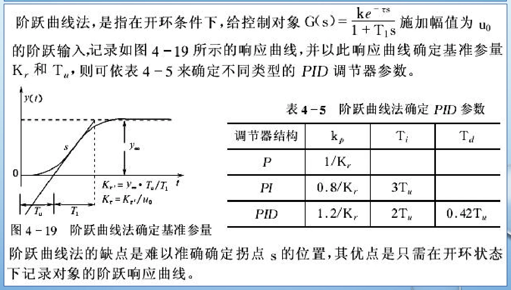

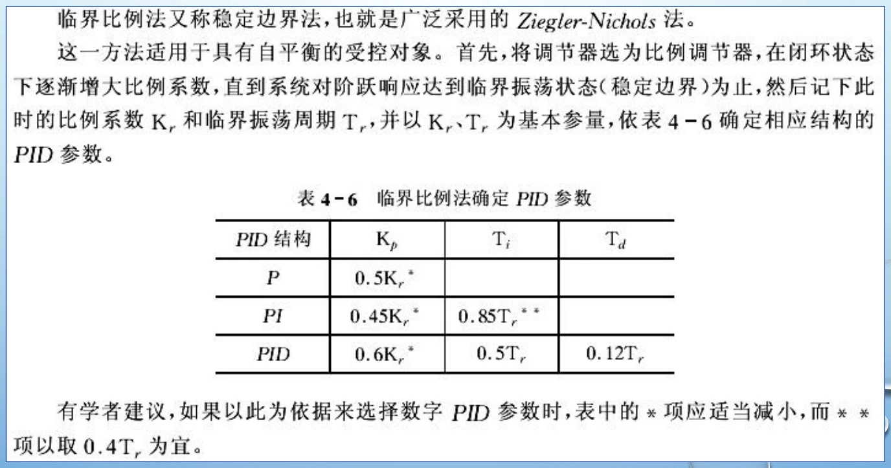

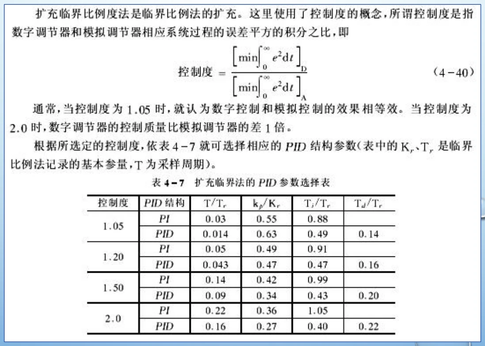

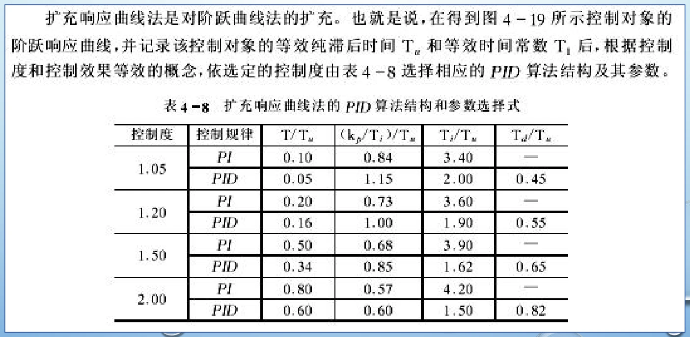

在临界比例法中，先关闭积分、微分，得到临界比例增益 \(K_u\) 与等幅振荡周期 \(P_u\)。课件经典 PID 初值为：

$$
\begin{gathered}
K_p=0.6K_u,\qquad T_i=0.5P_u,\qquad T_d=0.12P_u
\end{gathered}
$$

这一过程需要对象允许接近振荡状态；给定表格不能替代闭环检验。实际采样周期还受测量、运算、通信和执行器约束，下表只是课件按被控量列出的经验范围。

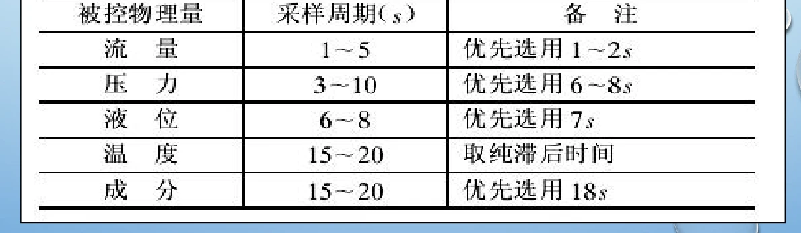

<!-- references:computer-control-chapter-04:5 -->
