# 第 5 章 · 直接数字设计

> 第 5 章 · 直接数字设计

## 5.1 直接数字设计的思路

直接数字设计从离散对象模型出发，直接选择期望的闭环行为，再求数字控制器；这与先设计模拟调节器再离散化的路线不同。设计前应明确采样周期、对象脉冲传递函数、反馈结构和输入类型。

在单位负反馈结构下，若期望闭环传递函数为 \(\Phi(z)\)，则满足 \(D(z)=\Phi(z)/[G(z)(1-\Phi(z))]\)。这个代数式只是起点，还必须检查得到的控制器能否因果实现、内部是否稳定、控制量是否可接受。

课件目录还列出达林算法，它同样属于按期望闭环特性设计的思路。当前资料的展开重点是最少拍设计；具体算法不能仅凭这个通用表达式就认定已经满足全部工程约束。

### 从期望闭环反求控制器

下面统一把闭环传递函数写成 \(\Phi\)，与课件中 H 的记号表示同一含义。单位负反馈下，误差与输出分别为：

$$
\begin{gathered}
\Phi(z)=\frac{D(z)G(z)}{1+D(z)G(z)},\qquad
\Phi_e(z)=1-\Phi(z)
\\D(z)=\frac{\Phi(z)}{G(z)[1-\Phi(z)]},\qquad
E(z)=[1-\Phi(z)]R(z)
\end{gathered}
$$

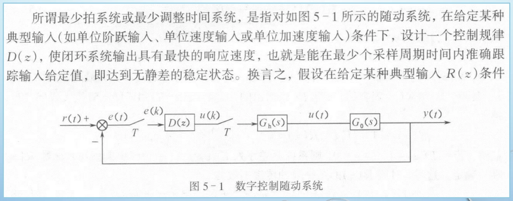

<!-- references:computer-control-chapter-05:1 -->

## 5.2 最少拍控制与有限拍响应

最少拍设计希望对指定类型的输入，使采样时刻的误差在尽可能少的采样周期后变为零。最少拍数取决于对象延迟、零点、输入类型以及可实现性和稳定性约束，不是对任意对象都能“一拍结束”。

设计时先表示给定输入及其变换，再构造满足有限拍误差要求的闭环传递函数与误差传递函数，最后求 D(z)。不同输入类型的稳态误差条件不同，因此阶跃输入下成立的设计不能直接当成斜坡输入的结论。

**必须区分：** 样值误差在有限拍后为零，不意味着采样间连续输出没有纹波，也不意味着控制信号不会出现过大的变化。评价设计时要把样值响应、采样间行为和控制量放在一起看。

### 用输入类型决定误差传递函数的因子

记 \(q=z^{-1}\)。典型多项式输入可写为 \(R(z)=A(q)/(1-q)^M\)。要让误差只含有限项，可以令 \(1-\Phi(z)=(1-q)^MF(q)\)，使输入的分母被消去。能否取 \(F=1\)，还要结合后两节的约束。

$$
\begin{gathered}
E(z)=(1-\Phi(z))R(z)=F(q)A(q)
\end{gathered}
$$

在暂时不加对象限制的理想情形中，M=1、2、3 分别对应阶跃、斜坡、抛物线输入，可取：

$$
\begin{gathered}
\Phi_1(q)=q,\qquad
\Phi_2(q)=2q-q^2,\qquad
\Phi_3(q)=3q-3q^2+q^3
\end{gathered}
$$

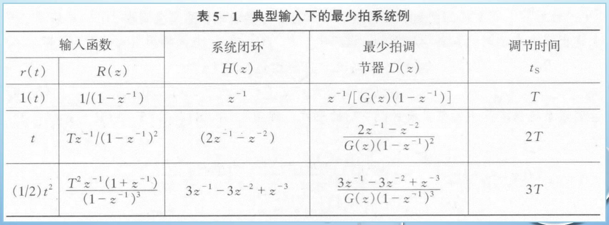

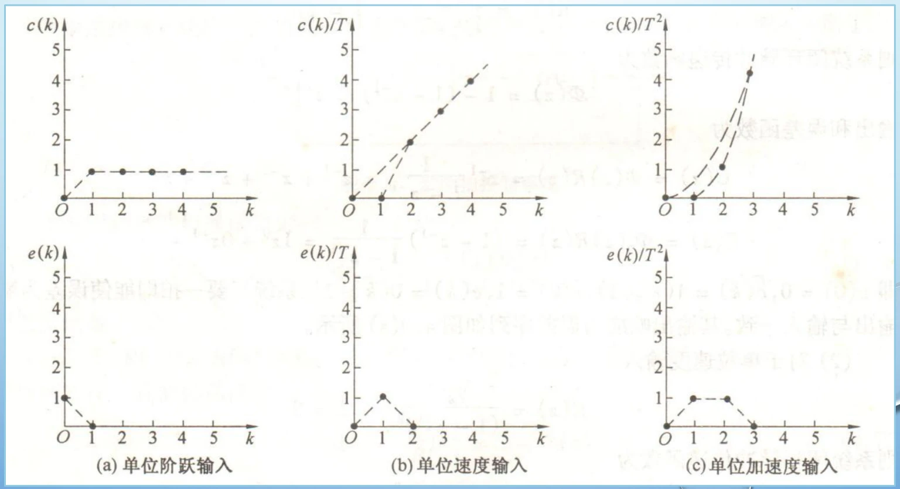

### 课件例题：斜坡输入的最少拍设计

给定 \(G_p(s)=10/[s(0.1s+1)]\)、\(T=0.1\ \mathrm s\)。先含保持器求 G(z)，再对单位速度输入取 \(\Phi=2q-q^2\)，最后代入反求控制器。下面把题目和推导接在同一处。

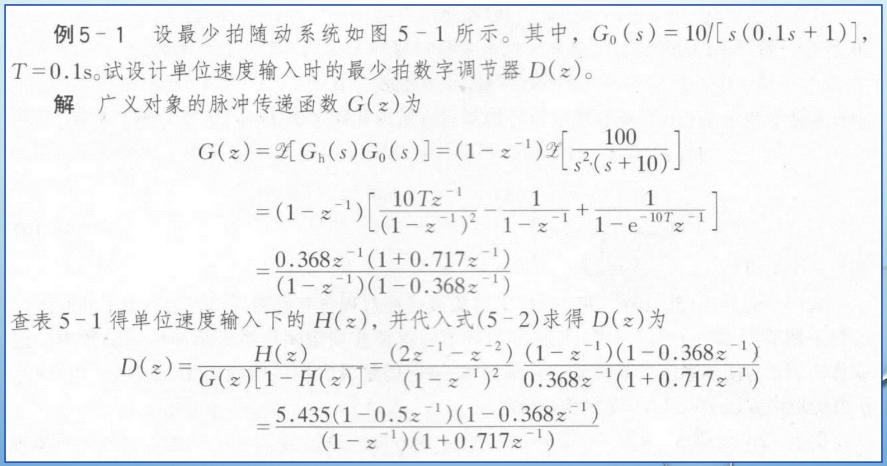

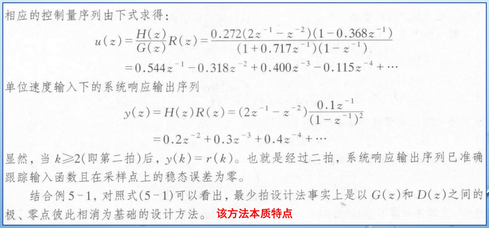

课件的输出序列从 \(0.2q+0.3q^2+0.4q^3+\cdots\) 开始，第二拍起与斜坡样值一致。这里的“有限拍”指采样时刻误差，并不能单凭这些样值保证拍间没有纹波。

<!-- references:computer-control-chapter-05:2 -->

## 5.3 数字调节器的可实现性

可实现性首先要求当前输出可以由当前及过去的信息计算，而不依赖未来样值。把 D(z) 写成 z⁻¹ 形式后，应检查是否存在不合理的超前项或需要额外延迟才能实现的关系。

对象本身的纯延迟、相对阶次以及期望闭环响应开始的时刻相互约束。如果对象不可能在某拍之前产生影响，就不能要求闭环在该拍之前完成相应响应。课件中的例题正是用这些条件修正最少拍结构。

可实现性不是编程语言能够写出公式就算满足；设计中需要的样值、状态和更新顺序必须在真实采样时序中可获得。

### 对象有 L 拍延迟，闭环也不能提前响应

若 \(G(q)=q^L B(q)/A(q)\)，且 \(B(0)\ne0\)，为使控制器因果，\(\Phi(q)\) 至少要含有同样的 \(q^L\) 因子。有限拍目标要在这个延迟基础上构造。

$$
\begin{gathered}
G(q)=q^L\frac{B(q)}{A(q)},\qquad
\Phi(q)=q^L M(q)
\\D(q)=\frac{M(q)A(q)}{B(q)[1-q^LM(q)]}
\end{gathered}
$$

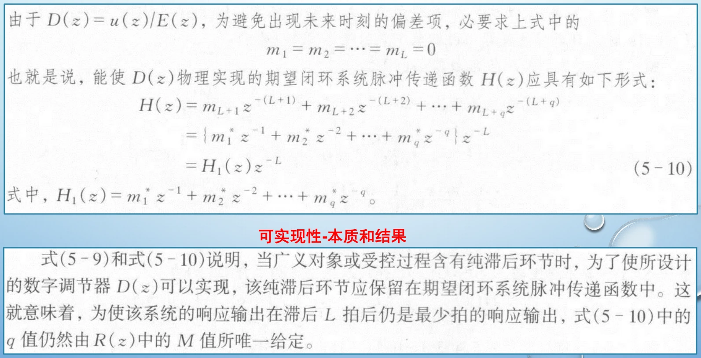

### 同一对象换采样周期后的例题

课件仍使用上一节对象，改为 T=0.5 s。先重新计算 G(z)；不能把 T=0.1 s 的离散模型直接拿来使用。下面的推导把对象延迟、闭环拍数和控制器的分子分母阶次一起核对。

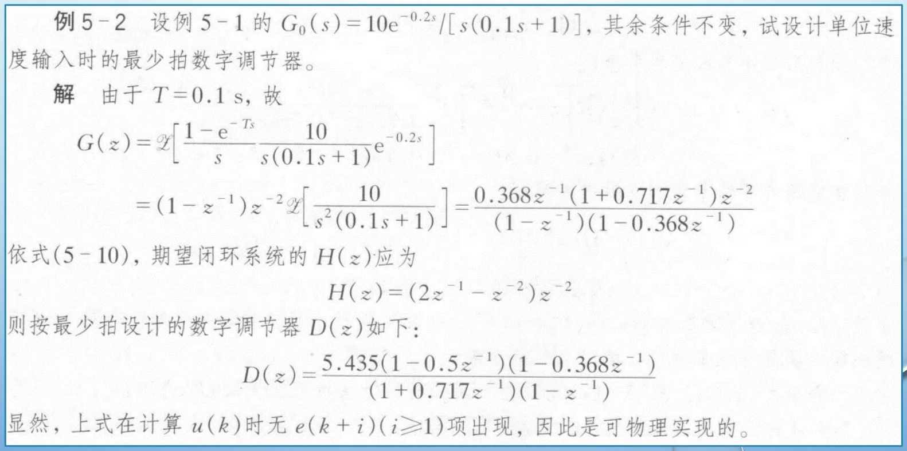

<!-- references:computer-control-chapter-05:3 -->

## 5.4 稳定性约束与极零点处理

离散系统的稳定极点应位于单位圆内。直接数字设计还要避免用形式上的极零点相消掩盖不稳定的内部环节：从输入输出比看似消去的因素，在初值、扰动或模型误差作用下仍可能引出问题。

因此，最少拍设计应同时满足有限拍要求、可实现性和稳定性条件。对象中的不稳定因素和非最小相位因素会限制闭环多项式的选择，不能为了减少拍数任意消去。

检查结果时，不仅要看闭环输出表达式，也要检查控制器、对象内部信号和控制量。若追求更快的响应导致很大的控制动作或对模型误差高度敏感，应重新权衡拍数与实际性能。

### 不稳定极点和非最小相位零点各约束什么？

对象的单位圆外零点不能被控制器的不稳定极点直接相消；应使期望闭环 \(\Phi\) 含相应零点因子。对象的单位圆外极点则要求 \(1-\Phi\) 含相应因子，使内部信号保持稳定。单位圆上的临界因素也须单独检查。

$$
\begin{gathered}
G(z_0)=0,\ |z_0|>1\quad\Longrightarrow\quad\Phi(z_0)=0
\\p_0\text{为对象不稳定极点}\quad\Longrightarrow\quad1-\Phi(p_0)=0
\end{gathered}
$$

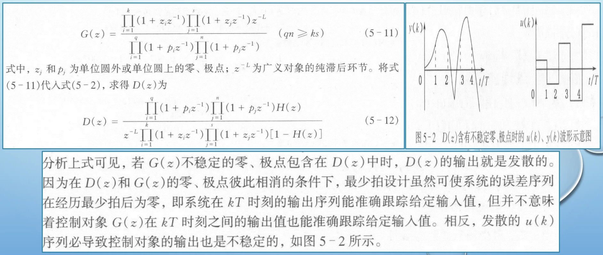

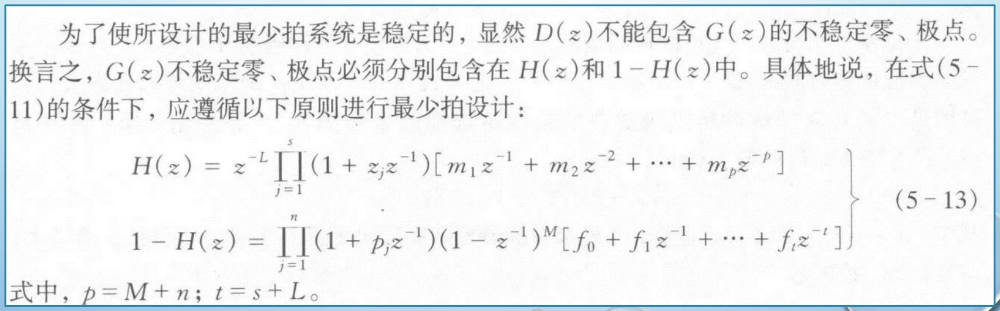

### 课件设计例题：保留单位圆外零点

对象为 \(10/[s(s+1)(0.1s+1)]\)，采样周期 0.5 s。其离散模型含约 −1.499 的零点，位于单位圆外，所以构造闭环时保留 \((1+1.499q)\) 因子；再用稳态条件确定系数。

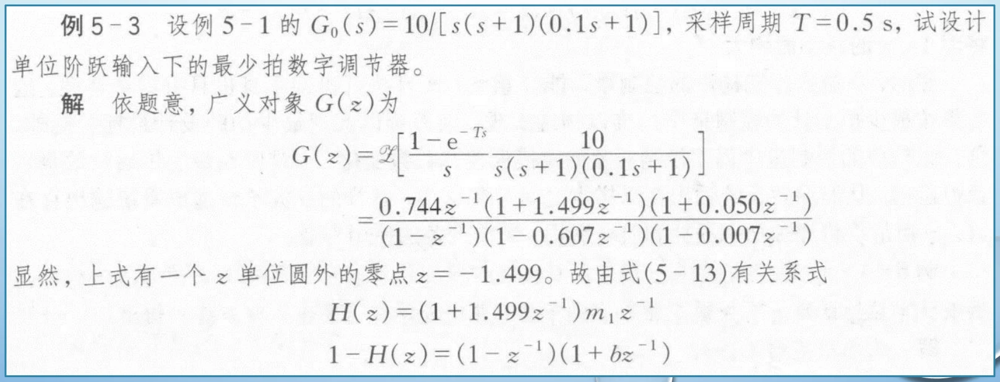

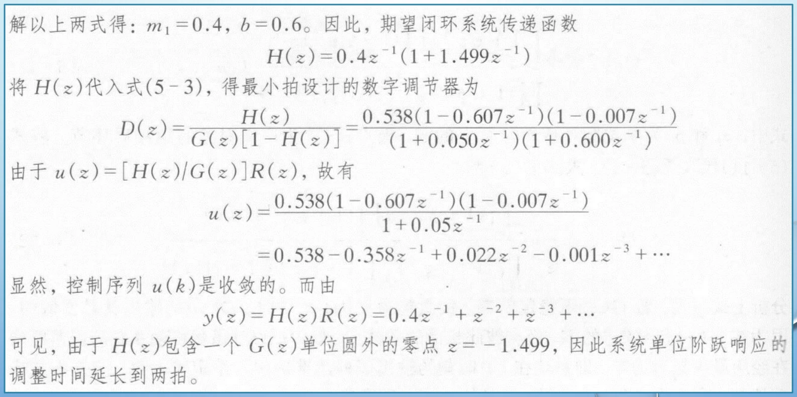

<!-- references:computer-control-chapter-05:4 -->

## 5.5 一道直接数字设计题的完整解题顺序

可把本章分散的设计问题合成同一条解题链：明确对象与采样周期 → 求 G(z) → 指定输入与期望响应 → 构造闭环和误差传递函数 → 求 D(z) → 检查可实现性与稳定性 → 写出递推式 → 核对输出和控制量。

解答中应说明“对什么输入、在什么模型和采样条件下”获得有限拍误差，而不是只写最终控制器。检查时可代入几个初始采样时刻，确认延迟、历史量与预期拍数一致。

本章与前面内容的联系是：第二章提供采样和接口条件，第三章提供离散对象模型与实现方法，第四章提供另一条设计路线。复习时将它们联系起来，才能解释一个数字控制器从理论到运行的全过程。

### 把求得的调节器真正落到递推式

设最后求得 \(D(q)=B_D(q)/A_D(q)\)，先把分母常数项归一化。下面各系数与前面的对象模型系数区别开，初值另行指定。

$$
\begin{gathered}
D(q)=\frac{b_0+b_1q+\cdots+b_mq^m}{1+a_1q+\cdots+a_nq^n}
\\u[k]=-\sum_{i=1}^{n}a_i u[k-i]+\sum_{j=0}^{m}b_j e[k-j]
\end{gathered}
$$

验证一题是否真正完成，需要同时算出输出和控制量。只看 \(Y/R\) 可能遗漏不稳定的内部相消，尤其要检查 \(U/R\)。

$$
\begin{gathered}
\frac{Y(z)}{R(z)}=\Phi(z),\qquad
\frac{U(z)}{R(z)}=\frac{\Phi(z)}{G(z)},\qquad
\frac{E(z)}{R(z)}=1-\Phi(z)
\end{gathered}
$$

回到 5.2 与 5.4 的两个完整例题，按同一顺序核对：对象和采样周期 → 含保持器的 G(z) → 输入类型 → 闭环与误差因子 → 可实现性 → 内部稳定性 → 控制器递推式 → 前几拍输出和控制量。只有输出误差、内部信号和执行能力都满足要求，才能接受设计。

<!-- references:computer-control-chapter-05:5 -->
